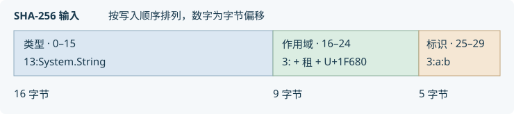

# 一次缓存命中，为什么还会分配内存？

假设订单已经在本机缓存里。业务有两种读法：把上次创建的 `CacheKey<T>` 直接交给 `GetOrCreateAsync`，或者先根据当前租户和订单号调用 `CreateKey<T>`，再去查缓存。两种读法都可以命中，但第二种每次都要重新生成物理键。用短 ASCII 输入实测，第二种读法从 **1,151.1 降至 909.2 ns/次**，托管分配从 **616 降至 232 B/次**。直接复用键的读法则一直是 **0 B/次**。

## 一个键如何写成字节

应用名取 `shop`，调用 `cache.CreateKey<string>("orders.v1", "租🚀", "a:b")`。应用名和区域是物理键中可见的前缀。摘要的输入依次是类型全名 `System.String`、作用域 `租🚀` 和资源标识 `a:b`。每段先写 .NET 字符串的 `Length`，再写冒号和原文。三段连起来就是 `13:System.String3:租🚀3:a:b`。



中间一段最容易算错。中文“租”占一个 UTF-16 代码单元，🚀 占两个，所以表示长度的是数字 **3**。编码为 UTF-8 时，“租”和 🚀 分别占 3 和 4 字节，加上前面的 `3:`，这段实际写了 **9 字节**。最后一段 `a:b` 里的冒号属于资源标识本身，有了长度就能区分字段边界。新旧代码都对同样的 30 个字节计算 SHA-256，得到同一个物理键：

```text
shop/orders.v1/e3d0ca006104d44cf227a9c156ef7216f8dd1fa325d019aeaacfd76a0d823e82
```

### 为什么三个 `Length` 加起来还不够？

`capacity` 是计算哈希前为临时缓冲预留的**字节数上界**。上例三个字段的 `Length` 之和是 `13 + 3 + 3 = 19`，单位是 UTF-16 代码单元。用 UTF-8 写出三个字段的原文需要 `13 + 7 + 3 = 23` 字节，还要写入 `13:`、`3:`、`3:` 三个长度前缀，共 7 字节。所以实际写入量 `used` 是 **30 字节**。

代码在写入之前用 `Utf8.GetMaxByteCount(19)` 估算原文最多需要的空间，这里得到 60 字节。公式中的 `3 * 11` 为三个长度前缀预留空间：每个 `Length` 是非负的 `int`，十进制最多 10 位，加一个冒号，最多占 11 个 ASCII 字节。于是 `capacity` 是 `60 + 33 = 93`。这样能在不预先逐个扫描字符串来精确计数的情况下备好缓冲。最后 `SHA256.HashData(bytes[..used], digest)` 只读取前 30 字节。`checked` 用于在容量算术溢出时抛出异常。

## 哪些分配消失了

旧实现先拼出上面的整条身份字符串，把它编码成新的 `byte[]`，再生成 32 字节摘要数组和 64 字符的十六进制字符串，最后才拼出物理键。

现在 `HashIdentity` 让 `WriteField` 按顺序把三段直接写到临时字节缓冲，并且只把**实际写入的字节**交给 SHA-256。容量上界在 512 B 以内时用栈空间；更长的身份从数组池借一块内存，在 `finally` 中带清空标志归还。类型全名也参与容量计算，泛型类型的长名称不会带来无界的栈分配。编码仍会拒绝孤立代理字符。

32 字节摘要和小写十六进制后缀也写在栈上。最终一次拼出 `应用名/区域/摘要`，连同 `CacheKey<T>` 返回。应用名与区域的字符检查直接对字符串区间执行。这样既能读出旧版本写入的条目，也能用新生成的键使旧条目失效。[建键实现](../GovernedCache.cs) · [旧物理键读写与失效测试](../../../test/MS.Microservice.Caching.Tests/GovernedCacheTests.cs)

## 耗时与托管分配

2026-11-26，Windows x64、Intel Core i5-9400、.NET SDK 11.0.100、运行时 11.0.0，Release。基线为 Git `469a76a`。L1 指同一实例中的本地缓存，命中样本读取预先写入的整数 42。所有场景的应用名和区域相同，最终物理键长度也相同。

| 每次公共 API 操作 | 旧 ns/次 | 新 ns/次 | 旧 B/次 | 新 B/次 |
| --- | ---: | ---: | ---: | ---: |
| 创建键，短 ASCII 作用域和资源标识 | 970.6 | 724.7 | 616 | 232 |
| 创建键，Unicode 作用域和标识达到 256 / 512 个 UTF-16 代码单元 | 11,012.9 | 9,929.6 | 3,928 | 232 |
| 创建键，泛型类型 `CachedPage<OrderDto>` | 1,619.7 | 1,319.5 | 928 | 232 |
| 复用预建键，L1 命中 | 124.5 | 119.5 | 0 | 0 |
| 每次创建短键，随后 L1 命中 | 1,151.1 | 909.2 | 616 | 232 |

长输入省掉的分配最多。它仍需编码所有字符、计算摘要并归还借用的缓冲。这个场景旧版三个进程的耗时中位数在 10.95–11.19 µs，新版在 9.88–11.37 µs，区间有重叠。预建键命中绕过了修改过的代码，表中的小幅时间差宜按测量波动理解。

分配按预热后当前线程的 `GC.GetAllocatedBytesForCurrentThread()` 差值计算，取整到字节。数组池首次租用可能分配新数组，归还后也可能保留容量；这里测量的是每次调用新增的托管分配。Redis 实库另做了共享读取、失效和过期的功能验证，表中的时间只覆盖本地操作。

## 怎样复现

在仓库根目录运行。比较旧版时，将当前基准项目的 `.csproj` 和 `Program.cs` 复制到 `469a76a` 独立检出目录的相同位置，在两个目录分别构建。

```powershell
$bench = 'MS.Microservice.Caching/benchmarks/MS.Microservice.Caching.Benchmarks'
dotnet build $bench -c Release
$env:DOTNET_TieredCompilation = '0'
dotnet run --no-build --project $bench -c Release
```

新旧各起三个进程，顺序为旧新、新旧、旧新。每场景预热后测七轮，每轮 20,000 次，长 Unicode 场景每轮 5,000 次。先取单进程的轮次中位数，再取三个进程的中位数。驱动对照原公式验证完整物理键；L1 命中一旦调用回源工厂就会失败。单独校验结果时可在运行命令末尾加 `-- --verify-only`。[基准源码](../../../benchmarks/MS.Microservice.Caching.Benchmarks/Program.cs) · [模块和宿主验收记录](../../../../docs/validation/CACHING-KEY-PERF/summary.md)
