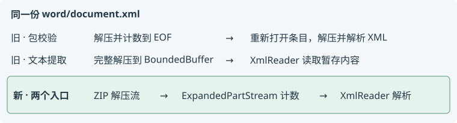

# DOCX 和 PDF 处理的代码评审

一份带 3.67 MB 照片的模板只填一个姓名，为什么旧版仍会复制整份文档？从 `FillAsync` 的输入顺着读，可以区分三种开销：保存调用方数据的独立副本、为了验证而读取内容、为了在两个内部方法之间传递数据而复制内容。下面给出各自的代码和取舍。[同机 Release 对照与复测命令](../../../../docs/validation/DOCUMENTS-RENDERING-PERF/summary.md)

## 提取正文时，谁需要完整的展开 XML

> 评审位置：`WordTextExtractor.PackageReader`。正文、12 个页眉会被逐个访问；每个部件在解析时都需要一份独立字节数组吗？

旧版先用 `CopyBoundedAsync` 把 ZIP 条目读进 `BoundedBuffer`，将位置归零，然后才把暂存流传给 `XmlReader`。这个复制循环每次最多还要分配一个 81920 字节的中转数组。XML 解析器只会向前读，所以现在可以直接消费展开流。[新的 ReadXmlAsync](../Word/WordTextExtractor.cs#L118)

```csharp
// 旧版 StoryAsync
using var buffer = await ReadAsync(path, cancellationToken).ConfigureAwait(false);
using var xml = CreateReader(buffer);

// 新版 ReadXmlAsync 的对应部分
using var part = new ExpandedPartStream(entry.Open(), _remainingBytes, cancellationToken);
using var xml = CreateReader(part);
result = await parse(xml).ConfigureAwait(false);
```

仅按 ZIP 目录标注的长度预检还不够。`ExpandedPartStream` 统计实际读出的字节，每次最多多读一个字节判断超限。假设预算剩 3 B，解析器请求 8192 B，实际只向解压流申请 4 B。若剩余内容正好 3 B，下一次读到 EOF 就成功；若读到第 4 B，当场报错。只有成功读完部件才从跨部件预算扣除 `BytesRead`。XML 字符上限、输出文本字符上限仍分别检查。[读取大小与计费](../Internal/ExpandedPartStream.cs#L18) · [精确上限和取消回归](../../../test/MS.Microservice.Documents.Tests/Word/ExpandedPartStreamTests.cs)



同一个读取器也用于 `WordPackage.CheckAsync`。旧版校验普通 XML 时，先把条目解压到 EOF 核算字节，然后重新打开条目解析。新版在解析这一遍时完成计费。二进制部件仍读到 EOF 检查预算；`[Content_Types].xml` 仍先用于确定部件类型。碰到 XML 语法错误等原有解析错误时，读取逻辑会检查剩余输入，保留原先解压失败或超限的错误优先级。对一个 1002656 B 的测试包，在压缩输入流上计数，整个包检查读取的字节从 2009296 降为 1006870。这是输入流读取量，不是 OS 磁盘 I/O 次数。[包检查](../Word/WordPackage.cs#L69)

旧写法 `text.ToString().TrimEnd('\n', '\t')` 先生成整篇字符串；有尾部分隔符且仍有正文时，再生成裁剪后的字符串。逐个执行 `text.Length--` 在长分隔符尾部又有跨块缩容成本。新版遍历 `text.GetChunks()`，在各块中用 `LastIndexOfAnyExcept('\n', '\t')` 找最后一个正文字符的绝对位置，最后调用一次 `text.ToString(0, length)`。中间表格中的换行和制表符、正文末尾的普通空格都保留。以 851968 个 UTF-16 码元的正文测整个提取入口，耗时从 **11.15 降至 9.77 ms**，分配从 **13.47 降至 8.90 MB**。数字包含读取、解析和字符串生成。[裁剪代码](../Word/WordTextExtractor.cs#L78) · [跨块尾部分隔符回归](../../../test/MS.Microservice.Documents.Tests/Word/WordTextExtractorTests.cs)

## 填控件时为什么可以少留一份 DOCX

```csharp
// 旧版：检查完 source，再完整复制一次
using var edited = new BoundedBuffer(limits.MaximumOutputBytes, "DOCX output");
source.Position = 0;
await source.CopyToAsync(edited, cancellationToken).ConfigureAwait(false);

// 新版：从读取输入起就让 edited 拥有唯一的工作副本
using var edited = new BoundedBuffer(limits.MaximumInputBytes, "DOCX input");
await edited.ReadFromAsync(template, cancellationToken).ConfigureAwait(false);
await WordPackage.CheckAsync(edited, limits, cancellationToken).ConfigureAwait(false);
// 在打开可编辑包之前
edited.ChangeWriteLimit(limits.MaximumOutputBytes, "DOCX output");
```

两份缓冲原来承担了两个不同的上限。新版保留的是阶段边界：先按输入上限读取并验包，再确认当前长度能放进输出上限，之后每次增长按输出预算约束。输出上限较小时，必要的容量收缩仍可能复制数组。调用方的模板始终独立，最终包通过校验后才写目标流。带 3670168 B JPEG 的样本只替换一个控件，耗时从 **18.28 降至 14.24 ms**，分配从 **24.02 降至 16.29 MB**；回读确认替换文本及未修改图片的完整字节。[FillAsync](../Word/WordTemplateProcessor.cs#L29) · [切换预算](../Internal/BoundedBuffer.cs#L48)

## PDF 快照在哪里需要独占数组

> 评审位置：`ReadSnapshotAsync`。输入是普通 `MemoryStream` 时，能否在读取之前就知道要保留多少字节？

旧版所有输入都经过“中转数组 → 可增长的暂存流 → `ToArray()`”。对于类型恰为 `MemoryStream` 且剩余数据处于预算内的输入，新版按 `Length - Position`（最少为 0）创建精确长度数组，再 `ReadExactlyAsync` 读取一份独立快照。不能直接借用调用方数组，因为后续解析需要稳定的内容。对派生流、不可寻址流和预算不足的输入，仍逐块按剩余额度读取。自定义流可以改变 `ReadAsync` 行为或提前返回，单凭 `CanSeek` 不能走这个分支。Word 输入也复用这套识别逻辑。[输入读取分支](../Internal/BoundedBuffer.cs#L5)

> 评审位置：`PdfProcessor.Save`。同一批序列化字节，写目标流和返回 `PdfPart` 对数组有什么不同要求？

```csharp
// Save 旧版                              // 新版
// var bytes = output.ToArray();
var bytes = output.GetBuffer().AsMemory(0, checked((int)output.Length));
```

暂存流由本次保存独占，其数组在 `MemoryStream.Dispose` 后仍可由这段内存引用。取有效长度可以排除备用容量。选页、合并、叠加在加密校验通过后，直接把这段内存写给目标流。`SplitAsync` 的公开返回值则是独立的 `byte[]`；它在交给调用方的边界调用 `ToArray()`，调用方可继续持有每个分片。选取 3671273 B 样本的一页，耗时从 **8.64 降至 5.46 ms**，分配从 **36.34 降至 22.18 MB**；17 B 一次短读的不可寻址对照，其检查路径的分配持平。[保存与加密验证](../Pdf/PdfProcessor.Buffers.cs#L103) · [分片输出](../Pdf/PdfProcessor.cs#L86)
