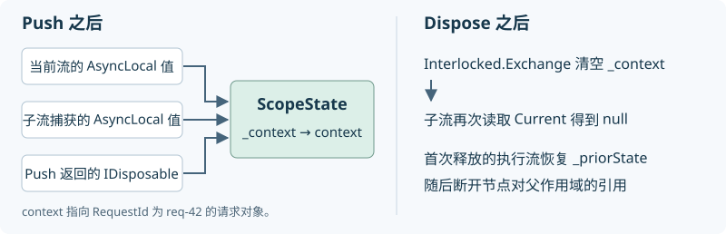

# 一个请求经过日志组件时，哪些工作可以省掉？

以 `GET /orders/42` 为例，中间件从请求头取到 `requestId=req-42`，将它放进当前日志作用域。业务处理期间可以写多条日志，响应结束时中间件再补上状态码和耗时。作用域的创建成本按请求支付，后端读取、包装字段的成本则按日志条数支付。在同机 .NET 11 基准中，每次进入和退出作用域少分配了 **32 B**。Serilog 给初始属性表为空的事件补齐七个字段时，每条少分配 **224 B**。[完整测量与复现](../../docs/validation/LOGGING-HOT-PATHS/summary.md)

## Core 如何让两个执行流同时看到作用域结束

旧代码在 `Push(context)` 中创建两个对象。`ScopeState` 保存请求上下文，随 `AsyncLocal` 流向子任务。`PopWhenDisposed` 作为释放句柄，记住当前和外层节点。调用者只在请求结束时用到这个句柄，而当前节点也恰好在那时失效。

现在 `ScopeState` 自己实现 `IDisposable`。`Push` 把同一个节点写入 `CurrentState.Value` 并返回给调用者。即使内外层传入相同的 `RequestLogContext`，两次 `Push` 也各有自己的节点。[RequestLogScope.cs](../src/MS.Microservice.Logging.Core/RequestLogScope.cs)



`Dispose` 的关键是一次原子交换。第一个拿到非空旧值的调用者恢复外层节点。重复或并发释放的其他调用者读到 `null` 后返回。

```csharp
if (Interlocked.Exchange(ref _context, null) is null)
{
    return;
}

CurrentState.Value = _priorState;
_priorState = null;
```

已排队的子任务可能仍然持有旧节点，但它通过 `Current` 再做查找时，`Volatile.Read` 会读到已清空的字段。最后一行断开节点对父作用域的引用。已经被业务代码单独保存的 `RequestLogContext` 引用仍可使用。[异步任务示例与生命周期边界](async-local-holder-lifetime.md)

## AspNetCore 在请求结束时采样一次

请求进入时，`CreateRequestLogContext` 取一次 `context.Request`，从同一个请求读取诊断头、方法和路径。下游返回 204 时，旧代码先读 `Response.StatusCode` 写入上下文，随后为事件 `5000` 再读一遍。现在 `finally` 用局部变量保存状态码和耗时，既更新上下文，也把同一组值交给日志委托。测试中的响应特性记录了成功路径恰好一次状态码读取。[MsRequestLoggingMiddleware.cs](../src/MS.Microservice.Logging.AspNetCore/MsRequestLoggingMiddleware.cs) · [中间件测试](../test/MS.Microservice.Logging.AspNetCore.Tests/MsRequestLoggingMiddlewareTests.cs)

| 下游结果 | 写入上下文的状态码 | 完成事件 |
| --- | --- | --- |
| 正常返回，包括已处理的 4xx、5xx | 响应状态码 | `5000` Information |
| 抛出异常且请求未取消 | 响应已开始时取状态码，否则为空 | `5001` Warning |
| 请求已取消，包括同时抛出异常 | 响应已开始时取状态码，否则为空 | `5002` Information |

`EmitCompletionLog=false` 只关闭最后一列。下游代码如果持有当前上下文，在请求结束后仍能看到最终状态和耗时。三请求头、同步完成的基准从 408 降到 376 B/请求；这 32 B 来自同一次 Core 作用域调整。两者的分配收益只计一次。

## NLog 用一次读取完成判空和输出

配置 `${requestId}|${platformId}|${userflag}` 时，旧渲染器为每个非空字段读取两遍 `RequestLogScope.Current`，一次判空，一次取值。现在每个渲染器把字段读到局部变量，对同一个值判空并追加。三个字段都存在时，环境上下文读取从六次减至三次。[RequestContextLayoutRenderers.cs](../src/MS.Microservice.Logging.NLog/LayoutRenderers/RequestContextLayoutRenderers.cs)

```csharp
var requestId = RequestLogScope.Current?.RequestId;
if (!string.IsNullOrWhiteSpace(requestId))
{
    builder.Append(requestId);
}
```

这也消除了两次读取之间父流释放作用域、第二次读取返回 `null` 的窗口。粒度是单个字段，各渲染器仍在执行时读取自己的值。空白字段输出为空。`${NetAddress}` 也只读取一次配置值。三个渲染器分别生成输出字符串的基准从 148.0 降到 131.3 ns/组三字段，分配均为 128 B。

## Serilog 在什么条件下可以直接添加请求属性

Serilog 4.3.0 的属性工厂可以创建一个包含名称和值的 `LogEventProperty`。旧的 enricher 对每个非空字段都创建这个包装对象，再调用 `AddOrUpdateProperty` 写入事件字典。以七字段事件为例，这条路径会创建七个包装对象，而事件字典最终只保存名称与属性值。[RequestLogContextEnricher.cs](../src/MS.Microservice.Logging.Serilog/RequestLogContextEnricher.cs) · [Serilog 4.3.0 的属性写入实现](https://github.com/serilog/serilog/blob/v4.3.0/src/Serilog/Events/LogEvent.cs)

新的 enricher 在写入第一个字段之前读取一次 `logEvent.Properties.Count`。根据这一刻的属性表，有两条路径。

| 进入 enricher 时 | 写入方式 | 调用者看到的结果 |
| --- | --- | --- |
| 属性表为空 | `AddPropertyIfAbsent(propertyFactory, name, value)` | 七个名称互不相同，Serilog 自带工厂可直接创建属性值并加入字典 |
| 已有任意属性，包括模板参数或 `SourceContext` | `AddOrUpdateProperty(propertyFactory.CreateProperty(name, value))` | 有值的请求字段继续覆盖同名事件属性，其他属性保留 |

例如模板自带 `requestId="event-id"` 时，只要当前作用域里的值是 `"req-42"`，最终事件就记录 `"req-42"`。空白字符串和缺失的数值沿用跳过规则；状态码仍是 `int`，耗时仍是 `long`。每条事件重新读取当前值，所以同一请求中较晚写入的完成事件可以看到刚填入的状态与耗时。[冲突与字段类型测试](../test/MS.Microservice.Logging.Serilog.Tests/MsSerilogProviderTests.cs)

普通七字段事件的分配从 984 降到 760 B/条，耗时中位数从 677.3 变为 705.5 ns/条。带同名模板字段的样本为 1048 B/条，耗时从 758.9 变为 795.0 ns/条。本轮启用日志的收益体现在空属性事件的分配量，两组耗时中位数均略高，进程间测量区间有重叠。

关闭日志还有一处独立成本。旧配置把 `LogLevel.None` 映射为 `Fatal`，Critical 调用仍会创建事件、填字段，最后才被过滤器丢弃。现在默认最低级别映射到 `LevelAlias.Off`，直接在事件创建前返回。后续配置若单独调低某个类别的阈值，总过滤器仍会拦住输出。无类别覆盖、携带七个请求字段的 Fatal 调用从 681.0 降到 8.5 ns/条，从 984 降到 0 B/条。[SerilogConfigurationFactory.cs](../src/MS.Microservice.Logging.Serilog/SerilogConfigurationFactory.cs) · [Serilog 对 Off 的定义](https://github.com/serilog/serilog/blob/v4.3.0/src/Serilog/Events/LevelAlias.cs)
