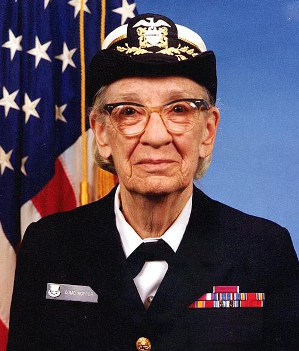
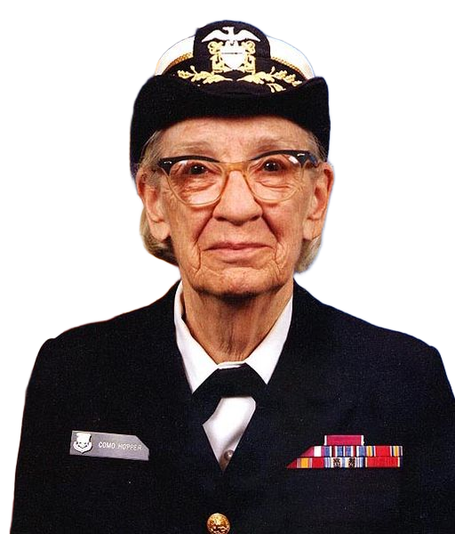

# BiRefNet 怎样把照片背景变透明

把下面这张 512×600 的人像交给 `RemoveAsync`，就能得到一张同样大小的透明 PNG。抠图时，**颜色取自原图，模型帮助决定每个像素还应显出多少**。如果还想看清哪些地方被保留下来，可以让它多输出一张灰度图，叫作**软蒙版**。

| 输入照片 | 软蒙版（可选输出） | 抠图结果（透明 PNG） |
| --- | --- | --- |
|  |  |  |

对照看帽沿就能读懂中间的图：白色的地方保留原图，黑色的地方让新背景完全透出来，灰色的边缘让两者都能看见。这个渐变让帽沿和头发可以有半透明的边缘。需要证件照底色时，把右图交给 `ImageProcessor` 铺在指定颜色上即可。[照片来源](../test/MS.Microservice.Media.Inference.Tests/BackgroundRemoval/Fixtures/README.md) · [调用示例](../src/MS.Microservice.Media.Inference/README.md#抠图与换背景)

## 跟着一个像素看两张输出

从左上角开始，以零为起点，看上图坐标为 `(253, 22)` 的像素。右图里这个像素的红、绿、蓝分别是 **58、70、118**，还有第四个数 **128**。第四个数叫 **alpha**，表示不透明度，范围是 0 到 255。这里的 128 表示这点蓝色大约显出一半，另一半由它下面的背景显出来。中间的蒙版在同一位置正好是灰度 **128**。它把同一个数画成了肉眼可见的灰色。

这个数由两部分相乘得到：程序读取原图的 alpha，再乘以模型在该位置估计的前景概率，最后取最接近的整数并限制在 0～255（恰在两个整数中间时取偶数）。例如，假设某处的前景概率为 0.5：

| 输入像素 | 计算 | 结果 PNG 的 alpha，也是蒙版灰度 |
| --- | --- | ---: |
| 普通 JPEG 像素，完全不透明 | 255 × 0.5 = 127.5 | 128 |
| 来自透明 PNG 的半透明像素 | 128 × 0.5 = 64 | 64 |
| 原本就透明的像素 | 0 × 0.5 = 0 | 0 |

这也解释了为什么使用蒙版时可以直接把灰度当作最终 alpha：第二行的 64 已经计入原图的半透明度，再乘一次会让边缘过淡。

## 模型怎样给原图上的每一点打分

1. **为模型准备一份图。** `ImageCodec` 解码照片并按文件里的 EXIF 方向把它摆正。模型只接收 1024×1024 的彩色输入，所以 `CreateTensor` 把透明部分按白底合成，再缩放到这个尺寸。白底只供模型观察，原图保留着，稍后还要从中取颜色。
2. **得到一张分数图。** 模型为 1024×1024 的每个位置给出一个分数，源码称为 `logit`。分数可以为负，也能大于 1。`ApplySigmoid` 把它换算成 0 到 1 之间的前景概率，例如分数 0 对应概率 0.5，较高分数对应较高概率。
3. **回到原图大小。** 对示例人像，`Compose` 要填回 512×600 个输出像素。原图某个位置落在概率图的几个采样点之间时，就按距离混合相邻点的概率。再用这个概率算 alpha，配上原图同位置的颜色，写入透明 PNG；调用方要求蒙版时，同时把这个 alpha 写成灰度。

所以，抠图输出可以保留衣服的原色，也可能保留发梢上原先混入的一点背景色。查看效果时应把透明 PNG 叠在实际要用的底色上。示例照片没有人工逐像素标注，帽沿和发梢仍需目视检查；`ReviewRecommended` 始终为 `true`。[像素处理源码](../src/MS.Microservice.Media.Inference/BackgroundRemoval/BackgroundPixels.cs)

## 这次优化为什么能省 4 MiB

变化发生在第 2 步。假设模型在一个位置给了 0 分。旧代码从分数数组里读出 0，算出 0.5，把 0.5 写到**另一张同样大的概率表**。整张图转换完成后，第 3 步只读概率，原始分数已经用完。

现在，模型输出的这块内存由本次调用独占。程序读完 0 分，就把 0.5 写回**同一个位置**。等整张表转换完，`Compose` 直接从这里读概率。即使两次输入照片的尺寸不同，每次省掉的数组也一样大，因为模型的分数图尺寸固定：

```text
1024 × 1024 个位置 × 每个 float 4 字节 = 4,194,304 字节 = 4 MiB
```

用上面的人像实际运行，两版各自产出的透明 PNG 和软蒙版都逐字节相同。每次调用的托管分配中位数从 **135.05 MB 降至 130.70 MB**，两版耗时均约 **15.2 秒**。这组数字衡量一次调用合计分配了多少托管内存；部署所需的进程峰值还包括模型推理期间使用的原生内存。[基准条件、输出哈希与复现方法](../../docs/validation/MEDIA-PIXEL-BUFFERS/summary.md)

## 部署时为什么仍要预留数 GiB 内存

224 MB 是模型文件的大小。运行时还要存放输入、各层的中间计算结果、解码位图、输出位图和编码缓冲。即使原图很小，模型也要处理完整的 1024×1024 个位置。单是输入的红、绿、蓝三层浮点数就占 12 MiB。

较早的一组双线程 CPU 对照专门测了 ONNX Runtime 缓存中间内存的影响。复用会话时，使用默认缓存的测试进程峰值约 **12.12 GiB**，每张耗时 **10.2～12.7 秒**。关闭 CPU 内存池和内存布局缓存后，五次处理的峰值约 **6.40 GiB**，每张耗时 **16.2～20.5 秒**。共同测试的四个样本输出像素一致。组件采用后一组设置，保留张量内存复用。在另一个使用 NuGet 包的独立进程中，加载会话用了 10.03 秒，一次人像处理用了 17.93 秒；峰值为 6.08 GiB，调用结束后工作集回落到 0.59 GiB。这些实测值可作为部署容量的起点，需要为宿主和并发任务另留余量。[ONNX Runtime 会话选项](https://onnxruntime.ai/docs/api/csharp/api/Microsoft.ML.OnnxRuntime.SessionOptions.html)

## 对照源码或排查问题时

- **模型加载。** 宿主预先安装指定的 BiRefNet-lite ONNX 权重。组件检查文件长度（224,005,088 字节）和 SHA-256，再把刚校验过的同一份字节交给 ONNX Runtime CPU 1.31.0。运行时无需下载权重或执行远程代码。固定版本、完整哈希、MIT 许可及模型来源可查[模型清单](../src/MS.Microservice.Media.Inference/worker/background-removal-modelmanifest.json)。
- **模型输入输出。** 输入 `input_image` 是 FP32，形状为 `[1,3,1024,1024]`，即一张图、红绿蓝三个通道，每个通道单独排成一层。各通道先换算到 0～1，再分别减去均值 `[.485, .456, .406]`、除以标准差 `[.229, .224, .225]`。缩放按像素中心取样，用相邻四点做双线性插值。与 PIL 的抗锯齿、8 位量化实现比较时，像素可能有差异。输出 `output_image` 只有一个分数通道，形状为 `[1,1,1024,1024]`。转换时按分数正负选择数值稳定的算法；遇到非有限值会在写 PNG 前报错。[模型加载与调用](../src/MS.Microservice.Media.Inference/BackgroundRemoval/BiRefNetBackgroundRemover.cs)
- **图片边界。** 默认输入上限为编码后 32 MiB、单边 4096、总计 4,000,000 像素。结果的尺寸和颜色基于方向校正后的解码图。解码时因低 alpha 而舍入或丢失的颜色无法恢复；要查看透明 PNG，请使用支持 alpha 合成的查看器。
- **复用与取消。** 同一实例复用会话并逐个处理请求，CPU 默认使用 `min(2, 逻辑 CPU 数)` 个线程。多个实例的总并发由宿主控制。取消会通知推理引擎停止，并在读取、像素处理和编码阶段检查；释放实例会阻止新工作、等待在途推理返回，再释放会话，排队请求不会读取输入。
- **流与失败。** 输入流、前景输出流和可选蒙版输出流应使用不同资源，从各自当前位置读写，结束后由调用方关闭。程序先写前景，再写蒙版。中途取消或写入失败可能留下不完整的文件；两张图必须一起交付时，先写入私有临时位置，全部成功后再发布。
- **验证覆盖。** 示例输出有 181,078 个非透明像素，带局部透明度的同一张人像有 162,768 个。全透明输入保持透明，旋转 90° 的样本输出为 600×512。测试还逐点核对软蒙版灰度与前景 alpha、检查极端分数和取消路径。纯色画面可能被模型全部判为背景。[像素测试](../test/MS.Microservice.Media.Inference.Tests/BackgroundRemoval/BackgroundPixelsTests.cs) · [真实模型测试](../test/MS.Microservice.Media.Inference.Tests/BackgroundRemoval/BiRefNetBackgroundRemoverTests.cs)
