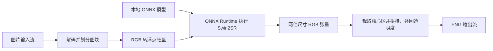

# 2 倍超分辨率设计

使用入口见 [Inference README](../src/MS.Microservice.Media.Inference/README.md#2-倍图片增强)。`Swin2SrUpscaler` 负责把普通图片转换成模型需要的数值，执行已经训练好的 Swin2SR 模型，再把结果组成两倍尺寸的 PNG。理解这段代码需要知道模型如何接收和返回图片，无需先学习模型训练或完整的神经网络结构。

## 模型、运行时与推理

训练阶段根据样本学习模型参数；推理阶段使用固定参数处理新的输入。本组件只执行推理，训练由模型发布者完成，不会根据调用方图片更新权重。Swin2SR 是用于图像重建的模型，这里固定使用轻量的 2 倍超分辨率版本，由模型预测放大后的 RGB 像素。超分辨率会产生看似合理的细节，不能据此认定原图确实包含这些细节。

| 名称 | 在本模块中的含义 |
| --- | --- |
| ONNX 模型文件 | 保存计算步骤和已训练参数的文件；本组件只接受清单指定的固定文件 |
| ONNX Runtime | 执行这些计算步骤的引擎；NuGet 包 `Microsoft.ML.OnnxRuntime` 提供 C# 接口及原生运行时，本组件使用 CPU |
| `InferenceSession` | 加载模型后得到的运行对象，持有模型及原生资源，可反复用于不同图片 |
| 张量（tensor） | 带有数据类型和维度的数值数组；这里保存 RGB 浮点数，不是 PNG／JPEG 编码字节 |
| 推理（inference） | 把输入张量交给模型，计算并取得输出张量；对应代码中的 `_session.Run(...)` |

命名空间中的 `Microsoft.ML` 不表示本模块接入了 ML.NET 的 `MLContext` 训练／预测管道。这里直接调用 ONNX Runtime，C# 代码负责图片预处理、分块、结果合成及资源管理；神经网络的计算结构和参数在 ONNX 文件中。OCR 入口另行启动 Python，而此处理器在 .NET 进程内调用原生运行时。

概念定义可参照官方 [ONNX 概念](https://onnx.ai/onnx/intro/concepts.html) 与 [ONNX Runtime C# 入门](https://onnxruntime.ai/docs/get-started/with-csharp.html)。后文的通道顺序、缩放和维度属于本组件所选模型的约定，不能套用于所有 ONNX 模型。

## 从图片到输出的流程

初始化与处理图片是两个阶段。`CreateAsync` 校验模型并创建一次会话，后续 `UpscaleAsync` 重用该会话。它与当前 OCR 的每次调用启动 Python、重新加载模型不同；每张图片重新创建处理器会重复承担模型加载成本。

阅读 [Swin2SrUpscaler.cs](../src/MS.Microservice.Media.Inference/SuperResolution/Swin2SrUpscaler.cs) 时，可按以下职责定位：

| 代码位置 | 负责的工作及原因 |
| --- | --- |
| `CreateAsync` / `VerifiedOnnxModel.ReadAsync` | 检查模型内容，创建会话并核对输入输出契约，避免把不兼容模型交给后续图片管道 |
| `UpscaleAsync` | 协调解码、图块遍历、模型运行和 PNG 编码，并落实并发、预算及取消约束 |
| `CreateTensor` / `Reflect` | 将图块转成指定通道顺序的浮点数组，并补齐模型需要的边界尺寸 |
| `OrtValue.CreateTensorValueFromMemory` | 给托管数组附上张量维度，供原生运行时读取；数据类型和排列必须与模型一致 |
| `_session.Run` / `RunOptions` | 执行模型，并为本次原生计算设置取消标记 |
| `Compose` / `ToByte` / `ScaleAlpha` | 读取输出张量、裁掉邻域和填充，转回 RGB 字节，并独立放大透明度 |
| `DisposeAsync` | 等待活跃操作结束，再释放会话持有的原生资源 |

## 用一个图块理解 NCHW

模型不能直接读取图片流，需要先把解码后的颜色排列成张量。这里使用 `float32`，每个颜色分量从 0–255 缩放到 0–1；例如不透明像素 `(255, 128, 0)` 变为约 `(1, 0.502, 0)`。透明像素的颜色先与白底合成，具体原因见后文预处理说明。

`NCHW` 表示维度依次为批次（N）、通道（C）、高度（H）、宽度（W）。本组件一次运行一块 RGB 图片，所以输入形状是 `[1, 3, H, W]`。这里 H、W 是包含邻域和填充的图块尺寸，不一定等于整张源图的尺寸。

`CreateTensor` 用一维 `float[]` 存放这些数值：先放完整的红色平面，再放绿色、蓝色平面。对于局部坐标 `(x, y)`，`plane = H × W`、`index = y × W + x`，红、绿、蓝分别位于 `index`、`plane + index`、`2 × plane + index`。因此这段下标计算是在排列三张颜色平面，不是在交错存放 `RGBRGB…`。

`pixel_values` 和 `reconstruction` 是固定模型的输入／输出节点名，可理解为调用模型时要匹配的参数名和结果名。输入节点接收 `[1, 3, H, W]`，输出节点返回 `[1, 3, 2H, 2W]`；代码检查实际返回形状，防止误读输出内存。

以远离图片边缘的完整核心块为例，默认 `TileSize = 128`、`ContextPixels = 16`：

| 阶段 | 尺寸或形状 | 含义 |
| --- | --- | --- |
| 核心块 | 128×128 | 最终要写入输出的源图区域 |
| 加上四周邻域 | 160×160 | 两侧各增加 16 像素，给模型提供相邻内容；160 已是 8 的倍数 |
| 输入张量 | `[1, 3, 160, 160]` | 一块图片、三个颜色通道，共 76,800 个浮点数 |
| 输出张量 | `[1, 3, 320, 320]` | 模型将包含邻域的区域放大两倍 |
| 写回核心区 | 256×256 | 从输出的 `(32, 32)` 开始裁取，舍弃用于计算的外围邻域 |

邻域让核心边缘的预测能参考相邻像素。只写回核心区可避免相邻图块重复覆盖；分块限制单次模型输入及中间张量规模，但整张输出画布仍需分配。图片边缘和不足一个核心块的尾部会按实际可用邻域及填充计算，不能把示例中的 160×160 当作所有调用的固定输入尺寸。

## 固定模型和会话

使用 Xenova 转换的 Swin2SR lightweight x2 ONNX。固定 revision、下载地址、文件大小和 SHA-256 见 [模型清单](../src/MS.Microservice.Media.Inference/worker/super-resolution-modelmanifest.json)。转换者的模型卡说明其来自 `caidas/swin2SR-lightweight-x2-64`，原作者固定版本模型卡声明 Apache-2.0。部署和分发需保留适用许可通知。

`VerifiedOnnxModel` 在限定大小的文件中读取完整内容，检查额外字节和 SHA-256；会话直接接收这份已验证字节数组，校验后不重新打开路径。构造会话失败或取消时释放原生资源。公开处理器只使用唯一的 `pixel_values` 浮点 NCHW 输入和 `reconstruction` 输出；每次运行再次检查输出为 `[1,3,2H,2W]`，所有数值必须有限。

每实例持有一个模型会话，以 SemaphoreSlim 串行执行。不同实例拥有独立模型和工作内存。异步释放先拒绝新操作，再等待活跃操作完成；已经排队的调用在获得锁后观察释放状态。

## 预处理和分块

`ImageCodec` 从输入当前位置检查编码大小、尺寸及像素预算，拒绝动画，统一 EXIF 方向。取规范化解码后的 RGB，与白色按源 alpha 合成，缩放至 `[0,1]`；模型不接收 alpha。这避免隐藏的透明黑色被当作不透明内容输入，但半透明边缘仍可能出现白底污染，组件不进行前景颜色反演。

输入分成不重叠核心块。每块向四周读取 `ContextPixels` 个实际邻域像素，遇到图像边界裁剪；右边、底边反射填充至至少 8 且为 8 的倍数。反射不重复边缘，长度为 1 的维度复制唯一像素。TileSize 和 ContextPixels 均为 8 的倍数，使内部块起点与模型窗口网格一致。

每块完成 2 倍推理后，只复制核心区域对应输出。核心不重叠，输出每个像素写入一次，不做跨块平均；工作张量大小由 tile 与 context 限制，输出画布仍一次完整分配。模型内部跨窗口和卷积感受野可能超出上下文，因此分块结果不保证与整图推理相同，边界可能出现接缝。增大上下文增加计算和内存，也不提供接缝消失或质量改善保证。

RGB 输出先拒绝 NaN／无穷，再限幅到 `[0,1]` 并舍入至 8 位。源 alpha 使用像素中心对齐的双线性插值，超出源边界时夹到边缘，独立扩展为两倍。模型不估计新 alpha，原图透明处不会被推理变成不透明。Skia 的预乘保存和 PNG 编码仍会带来低 alpha 颜色量化；不能承诺隐藏 RGB 位级保留。

## 预算、取消和流所有权

输入与两倍输出分别检查单边和像素上限，分配输出前完成输出预算检查。tile/core/context 在构造时受限，最大上下文画布为 384×384。输出 PNG 字节量由调用方控制；光栅预算不是进程内存硬配额，也不约束编码器内部缓冲。

取消在输入读写、每行处理和块边界检查。每次原生 Run 使用独立 RunOptions，并注册取消以设置 Terminate；原生调用结束后再释放张量和结果。取消导致的 ONNX 异常转换为调用方取消异常，下一次调用使用新的 RunOptions。同步图片解码和编码不能被抢占，不能承诺严格取消延迟。

输入输出必须是不同的可读／可写流，始终保持打开，不依赖输入 seek。PNG 编码完成后写到调用方当前位置；写入失败或取消可能留下部分输出，组件不发布文件或提供流事务。宿主需写私有暂存结果并在成功后发布。

## 验证范围

[测试](../test/MS.Microservice.Media.Inference.Tests/SuperResolution/Swin2SrUpscalerTests.cs)检查真实固定模型的 1×1、小型奇数尺寸、跨 tile 的非正方形图片、全透明和半透明图片、输出预算、当前流位置、非 seekable 输入、取消后复用及重复释放。条纹输入的输出必须包含模型生成的中间灰度，以排除单纯复制像素冒充超分辨率；这不构成质量评测。

独立算法回归检查反射边界、双线性 alpha 的已知数值和模型内容快照。已验证 Windows x64 CPU 运行路径；其他原生平台需目标环境验收。超分辨率会合成纹理，也可能平滑、扭曲文字或产生伪细节，结果始终建议人工检查，不用于证明原图包含某个细节。
