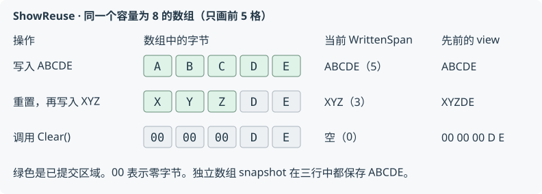

# ArrayBufferWriter 使用指南

假设要向同一段内存先写入 `AB`，再追加 `CDE`。你需要知道两件事：数组还剩多少空间，以及前面有多少内容已经可以交给下游。`ArrayBufferWriter<T>` 帮你维护数组和写入位置；空间不足时，它会扩容。你负责告诉它**本次实际写了几个元素**。在收件箱代码里，`ResetWrittenCount`、`GetMemory`、`Advance` 和 `WrittenSpan` 正好分别对应开始一份文件、取得空间、提交有效字节和解析结果。

本文以 .NET 11 的 `ArrayBufferWriter<byte>` 为例。可以在仓库根目录一次运行所有 demo，无需启动服务或下载数据。下面每段输出都能用行首的英文标识在程序里找到。[完整可运行示例](../../samples/Guides/ArrayBufferWriterDemo.cs)

```powershell
dotnet run --file samples/Guides/ArrayBufferWriterDemo.cs -c Release
```

## 写入 AB 后为什么还要调用 Advance

看示例里的 `ShowAppend`。初始数组能放 4 个字节，`WrittenCount` 从 0 开始。

```csharp
var buffer = new ArrayBufferWriter<byte>(initialCapacity: 4);
Span<byte> destination = buffer.GetSpan(2);
"AB"u8.CopyTo(destination);
// 此刻数组里已有 A、B，WrittenCount 仍然是 0。
buffer.Advance(2);

"CDE"u8.CopyTo(buffer.GetSpan(3));
buffer.Advance(3);
```

`"AB"u8` 是 UTF-8 字节字面量，含两个字节。`GetSpan(2)` 从当前写入位置给出**至少**两格可写空间；`CopyTo` 才真正填写这两格。writer 无法从一个可写视图推断你用了多少格，所以第一次 `Advance(2)` 之前，消费者看见的有效输出仍为空。

```text
append/before: count=0, text=''
append/after: count=2, text='AB'
append/grown: count=5, text='ABCDE'
```

再申请三格时，原数组只剩两格，writer 会扩容并保留已提交的 `AB`。新取得的切片从 `B` 之后开始，提交 3 后，总数变成 5。**每次 `Advance` 传本轮增加量**；第二次传 5 等于声称这一轮又填了五格。writer 可以检查是否越过容量，却无法检查你是否真的给这五格都赋过值。有现成的一段源数据时，BCL 的扩展方法 `buffer.Write("CDE"u8)` 会替你完成申请、复制和提交，调用后直接读结果即可。[IBufferWriter 写入契约](https://learn.microsoft.com/dotnet/api/system.buffers.ibufferwriter-1.getspan?view=net-11.0) · [Write 扩展方法](https://learn.microsoft.com/dotnet/api/system.buffers.buffersextensions.write?view=net-11.0)

## 常用签名怎么读

类型在 `System.Buffers` 命名空间。`T` 表示一个元素：`T = byte` 时计数单位是字节，`T = char` 时则是 UTF-16 码元。下表中的 `sizeHint`、`count` 和容量都沿用这个单位。[ArrayBufferWriter API](https://learn.microsoft.com/dotnet/api/system.buffers.arraybufferwriter-1?view=net-11.0)

读签名时把 `Span<T>` 理解成“从某个位置开始的连续几格”。对 writer 返回的切片赋值会直接改到底层数组。`Memory<T>` 也能描述这段区域，而且可以交给需要跨 `await` 完成的操作。两者前面若有 `ReadOnly`，表示拿到这个视图的人只能读；数组的拥有者仍可改动内容。

| 构造器或成员 | 调用时你需要知道什么 |
| --- | --- |
| `ArrayBufferWriter<T>()` | 还不知道通常会写多少时使用，按需取得空间。 |
| `ArrayBufferWriter<T>(int initialCapacity)` | 已知典型大小时预留正数个元素，减少扩容。初始容量可以被超过；显式传 0 会抛异常。 |
| `Span<T> GetSpan(int sizeHint = 0)` | 取得从当前写入位置开始的可写切片，适合同步编码、填充或复制。省略参数或传 0 也会得到非空空间。 |
| `Memory<T> GetMemory(int sizeHint = 0)` | 同样提供可写空间，可传给 `Stream.ReadAsync` 等异步 API。若希望单次最多读 8 字节，要自己取 `[..8]`。 |
| `void Advance(int count)` | 提交刚刚写好的元素数。允许提交 0。下一轮写入要重新取切片，负数或超出可用容量会抛异常。 |
| `int WrittenCount`、`int Capacity`、`int FreeCapacity` | 分别为已提交长度、底层数组总容量、无需扩容还能写入的长度。当前实现中 `FreeCapacity = Capacity - WrittenCount`。 |
| `ReadOnlySpan<T> WrittenSpan`、`ReadOnlyMemory<T> WrittenMemory` | 查看从数组开头到当前已提交位置的前缀。前者适合同步解析，后者可传给异步消费者；取视图本身不会复制内容。 |
| `void ResetWrittenCount()`、`void Clear()` | 都保留容量并把计数归零。`ResetWrittenCount` 只重置位置；`Clear` 还清零当前已提交的前缀。 |

你也会遇到参数类型为 `IBufferWriter<byte>` 的方法。这个接口只要求 `GetSpan`、`GetMemory` 和 `Advance`，足够让一个编码器向调用方提供的目标写数据。持有具体 `ArrayBufferWriter<byte>` 的调用方才可以再用 `WrittenSpan` 读回结果。下面的 JSON demo 就是这两种角色的配合。

## 复用时旧视图和独立副本有什么区别

`ShowReuse` 用容量 8 的数组写入 `ABCDE`，随后保留两份“结果”。`view` 记住数组和长度 5；`snapshot` 拷贝五个字节，拥有自己的数组。这个例子特意让第二次写入也能装进原数组，便于直接看到覆盖。

```csharp
buffer.Write("ABCDE"u8);
ReadOnlyMemory<byte> view = buffer.WrittenMemory;
byte[] snapshot = buffer.WrittenSpan.ToArray();

buffer.ResetWrittenCount();
buffer.Write("XYZ"u8);
// 此处分别读取 buffer.WrittenSpan、view.Span 和 snapshot
buffer.Clear();
```

```text
reuse/reset: count=0
reuse/overwritten: current=XYZ, oldView=XYZDE, copy=ABCDE
reuse/clear: count=0, oldViewHex=0000004445
```



图里最容易漏看的是 `D`、`E`。第二次只提交了三格，因此 `Clear()` 只清零这三格。原视图仍有五格，最后读到十六进制 `00 00 00 44 45`。`ResetWrittenCount()` 在 .NET 11 中是 O(1)，`Clear()` 的清零工作随当时的 `WrittenCount` 增长。若先重置再清零，当时的计数已经是 0。遇到扩容时，旧视图还可能指向旧数组，不能靠保存旧视图来追踪新结果。[运行时实现](https://github.com/dotnet/runtime/blob/v11.0.0/src/libraries/Common/src/System/Buffers/ArrayBufferWriter.cs)

**怎样决定是否复制？** 在当前方法内立即反序列化，可以直接消费 `WrittenSpan`。异步发送时，可以 `await output.WriteAsync(buffer.WrittenMemory, token)`，等它完成再复用 writer。如果要把结果放入队列、缓存或交给另一个生命周期独立的任务，`ToArray()` 能给它独立所有权。每次并发操作各用自己的 writer，也能避免另一个调用提前重置你的数据。

## 异步读取时应该提交多少字节

`ShowShortReadAsync` 把 `猫A` 编成 UTF-8 放进 `MemoryStream`，申请 8 字节空间并只读一次。这里有三个不同的长度：字符串有几个 UTF-16 码元、传给流的目标有多长、流实际填了几个字节。

```csharp
const int requested = 8;
Memory<byte> destination = buffer.GetMemory(requested)[..requested];
int read = await input.ReadAsync(destination);
buffer.Advance(read);
```

```text
read/source: text=猫A, utf16Length=2, hex=E78CAB41
read/short: requested=8, read=4, count=4, text=猫A, bytesEqual=True
```

`猫` 用三个 UTF-8 字节 `E7 8C AB`，`A` 用一个字节 `41`。这里应提交 `read` 的 4；提交 `original.Length` 的 2 会截断第一个字符，提交 `requested` 的 8 则会把四个未填写的位置交给下游。对普通流，一次短读之后还可能有更多数据；需要整个输入就继续读取，每轮重新取空间，读到 0 再结束。实际读写必须设定数据量上限，`sizeHint` 本身不限制最终能累积多少数据。

### 对照仓库里的收件箱

依次看 `ListAsync` 和 `ReadJsonAsync<T>`，这能解释为什么优化后读文件时反而出现了一个叫 *writer* 的对象：文件流提供数据，writer 提供这些字节要写入的目的地。[ListAsync](../../src/MS.Microservice.Notifications/Inbox/LocalNotificationInbox.cs#L54) · [ReadJsonAsync](../../src/MS.Microservice.Notifications/Inbox/LocalNotificationInbox.cs#L166)

1. `ListAsync` 在一次目录扫描中创建一个 writer。读取每份通知或回执时，`ResetWrittenCount()` 将有效前缀清空，让这次文件从下标 0 写起。
2. 用打开的文件句柄取得长度，先检查单文件上限与本次扫描剩余预算，再从 `GetMemory` 的返回值切出 `data`。此处文件应当不可变，`ReadExactlyAsync(data, token)` 成功意味着这一段已经读满。
3. 再探测一次 EOF。确认没有额外字节后才 `Advance(data.Length)`；随后 `JsonSerializer.Deserialize<T>(buffer.WrittenSpan)` 只看到这次文件的内容。
4. 返回解析出的对象和 `WrittenCount`。如果先读了 2048 字节通知，再读 27 字节回执，两次返回 2048 和 27，扫描累计为 2075。复用数组时，已返回的通知对象仍然可用。

历史上导致大量分配的是每份文件重建缓冲和反复复制。单独比较“返回缓冲切片”和“在读取方法中提交并解析”，半数已读、首页 8 封的托管分配从 885816 降到 884280 B，各分页场景的耗时有升有降。选择后者的主要理由是让调用方无需遵守隐含的视图借用顺序。[性能笔记](../../src/MS.Microservice.Notifications/docs/notification-performance.md#为什么要在读取方法内把字节变成对象) · [完整对照](../validation/INBOX-JSON-BUFFER/summary.md)

## 用 Utf8JsonWriter 写 JSON 时由谁提交

`ShowJson` 生成同一个 JSON 对象。第一种写法让序列化器直接返回一个独立的 `byte[]`。第二种写法由调用者提供 writer，逐个写入属性，随后直接读取已提交的内存。

```csharp
var notice = new { Id = 7, Read = true };
byte[] independent = JsonSerializer.SerializeToUtf8Bytes(notice);

var buffer = new ArrayBufferWriter<byte>();
using (var json = new Utf8JsonWriter(buffer))
{
    json.WriteStartObject();
    json.WriteNumber("Id", notice.Id);
    json.WriteBoolean("Read", notice.Read);
    json.WriteEndObject();
    json.Flush();
}
```

```text
json/serializer: {"Id":7,"Read":true}
json/writer: {"Id":7,"Read":true}
json/compare: bytes=20, equal=True
```

`Utf8JsonWriter` 自己通过 `IBufferWriter<byte>` 取得空间并提交。`Flush()` 确保待写的 JSON 已交给目标；调用方再执行 `Advance(20)` 会额外发布一段数据。这两种写法对示例产生逐字节相同的输出，却把字节的所有权交给了不同的对象。仓库的 `JsonText.Format` 使用相同的组合：把 JSON 元素写入 `Utf8JsonWriter`，离开 `using` 块后直接从 `buffer.WrittenSpan` 解码最终字符串，省去中间的 `byte[]` 快照。返回的字符串本身仍需分配。[JsonText.Format](../../src/MS.Microservice.Core/Serialization/JsonText.cs#L14) · [Utf8JsonWriter.Flush](https://learn.microsoft.com/dotnet/api/system.text.json.utf8jsonwriter.flush?view=net-11.0)

## 为一份独立快照多付出多少分配

`ShowAllocations` 做两组相同的工作。先准备好 4096 字节的输入和足够容量的 writer；每轮重置、写入、逐字节核对。两组唯一不同的是核对数据前的这一行：

```csharp
ReadOnlySpan<byte> output = copy ? buffer.WrittenSpan.ToArray() : buffer.WrittenSpan;
```

```text
alloc/input: payload=4096 B, iterations=1024
alloc/view: 0 B total, 0 B/op
alloc/snapshot: 4218880 B total, 4120 B/op
```

两种结果的内容完全相同。直接消费视图时，本机预热后的同步循环没有新增托管分配；每轮获取独立快照则多出一个 `byte[4096]`，连同数组本身的开销实测每轮 4120 B。这个实验用 `GC.GetAllocatedBytesForCurrentThread()` 统计当前线程，两条路径分别预热 16 轮，初始化和打印都在计量之外。writer 的底层数组早已分配，写入时也都发生了从输入到目标的复制。这里的 0 B 只说明复用后的增量分配；4120 B 是本机 .NET 11 的读数。[分配对照的完整循环](../../samples/Guides/ArrayBufferWriterDemo.cs#L78)

## 换个场景该怎么选

| 你的场景 | 合适的做法与理由 |
| --- | --- |
| 最终长度事先未知，要分段生成一段有界的连续输出，例如编码一个报文 | 用 `ArrayBufferWriter<byte>`。让编码器接收 `IBufferWriter<byte>`，直接在目标区域填写；长度估算可靠时可预设初始容量，减少扩容时的分配和搬移。 |
| 已知最终长度，下游需要长期拥有一份数组 | 可以一次创建目标 `byte[]` 并填满。简单对象导出 JSON 时，`SerializeToUtf8Bytes` 已直接提供独立结果。 |
| 现有库只接收 `Stream`，或需要 `Position`、`Seek` | 用 `MemoryStream` 适配流接口。其 `ToArray()` 也会生成独立副本；能接受流的消费者通常可以直接读流。 |
| 需要在很多独立操作间租还临时数组，手里已有可靠的归还时机 | 考虑 `ArrayPool<byte>`。租用方自己管理有效长度、归还和清理。`ArrayBufferWriter<T>` 管理普通托管数组，复用同一 writer 时能复用其容量。 |
| 数据可能非常大，或生产者和消费者速度不同，需要边写边读 | 按块在流之间传递，或使用有背压的 `Pipe`。长期复用一个偶尔写入超大结果的 writer 会留下高水位容量；`Clear` 和 `ResetWrittenCount` 都不会主动缩小它。 |
