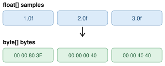

# 对照源码读懂音频编辑、静音与批量处理

## 四帧声音怎样淡入又淡出

`AudioEditor.EditAsync` 接收的时长以时间表示，`Edit` 把它换成帧数。一帧包含同一时刻每个声道的一个样本。编辑选项的默认增益是 1，在测试的四帧单声道输入 `[1, 1, 1, 1]` 上，设淡入和淡出各占三帧。处理每一帧时，下面两条乘法可以同时生效。[编辑选项](../AudioEditOptions.cs#L18) · [时间换算](../AudioEditor.cs#L171) · [淡变循环](../AudioEditor.cs#L147)

```csharp
var position = processed + frame;
var remaining = frames - position - 1;
double gain = volume;
if (position < fadeIn)
    gain *= fadeIn == 1 ? 0 : (double)position / (fadeIn - 1);
if (remaining < fadeOut)
    gain *= fadeOut == 1 ? 0 : (double)remaining / (fadeOut - 1);
```

| 帧位置（从 0 起） | 0 | 1 | 2 | 3 |
| --- | ---: | ---: | ---: | ---: |
| 淡入系数 | 0 | ½ | 1 | 1 |
| 淡出系数 | 1 | 1 | ½ | 0 |
| 输出样本 | 0 | 0.5 | 0.5 | 0 |

分母 `fadeIn - 1` 让三帧淡入在位置 2 达到完整音量。若换成立体声，代码先算一帧的系数，再将它用于左、右两个样本。每个样本都检查有限性，乘积限幅到 `[-1, 1]`。位置中的 `processed` 让淡变越过缓冲边界时继续计数。[按声道应用增益](../AudioEditor.cs#L154) · [四帧回归测试](../../../test/MS.Microservice.Audio.Tests/AudioEditorTests.cs#L93)

这个循环还有一笔容易误读的成本。`float[]` 和 `byte[]` 都在整次编辑开头建一次，`Buffer.BlockCopy` 则在每块写出前搬运有效样本。共用两种数组视图可省掉这份复制。已有候选实现降低了分配，但增益与淡变两种公开入口工作负载的耗时都未稳定改善，现行代码保留了两个数组。[缓冲创建](../AudioEditor.cs#L131) · [每块复制](../AudioEditor.cs#L164) · [前次对照结果](../../../docs/validation/AUDIO-PROCESSING-PERF/summary.md)

> `Buffer.BlockCopy` 是 C# 中的**内存数据复制操作**，作用是：
>
> **将** `float[]` **数组中的浮点数，按照其内存中的二进制表示，直接复制到** `byte[]` **数组中。**
>
> ```
> Buffer.BlockCopy(samples, 0, bytes, 0, read * sizeof(float));
> ```
>
> ### **1. 参数解释**
>
> `Buffer.BlockCopy` 的方法定义：
>
> ```
> Buffer.BlockCopy(
>     Array src,       // 源数组
>     int srcOffset,   // 源数组起始字节偏移
>     Array dst,       // 目标数组
>     int dstOffset,   // 目标数组起始字节偏移
>     int count        // 复制的字节数
> );
> ```
>
> 对应你的代码：
>
> | 参数                   | 含义                      |
> | ---------------------- | ------------------------- |
> | `samples`              | 源数组，通常是 `float[]`  |
> | `0`                    | 从源数组第 0 个字节开始   |
> | `bytes`                | 目标数组，通常是 `byte[]` |
> | `0`                    | 从目标数组第 0 个字节开始 |
> | `read`                 | 本次实际读取的 float 数量 |
> | `sizeof(float)`        | 每个 float 占 4 字节      |
> | `read * sizeof(float)` | 实际需要复制的总字节数    |
>
> ### **2. 举个例子**
>
> ```
> float[] samples = { 1.0f, 2.0f, 3.0f };
>
> int read = 3;
>
> byte[] bytes = new byte[read * sizeof(float)];
>
> Buffer.BlockCopy(samples, 0, bytes, 0, read * sizeof(float));
>
> Console.WriteLine(BitConverter.ToString(bytes));
> ```
>
> 在常见的小端序系统中，输出：
>
> ```
> 00-00-80-3F-00-00-00-40-00-00-40-40
> ```
>
> 内存复制示意
>
> 
>
> 3 个 float × 4 字节 = 12 个 byte
>
> ### **3. 需要特别注意**
>
> **这不是把 float 转成整数 byte，而是复制 float 的原始二进制数据。**
>
> 例如：
>
> ```
> float value = 1.0f;
> ```
>
> 它对应的 IEEE 754 单精度浮点数二进制表示为：
>
> ```
> 0x3F800000
> ```
>
> 在小端序系统中，复制后的字节是：
>
> ```
> 00 00 80 3F
> ```
>
> ### **4. 如果是音频处理**
>
> 如果 `samples` 是音频采样数据：
>
> ```
> float[] samples;
> byte[] bytes;
> ```
>
> 这行代码通常是在把 **32 位浮点 PCM 音频（Float32 PCM）转换成字节流**，便于写入文件或网络传输。
>
> 注意：它**不会将 Float32 PCM 转换为 16 位 PCM**。如果目标需要 PCM16，就必须先进行数值缩放和格式转换，不能直接使用这行代码。
>
> **总结：**`Buffer.BlockCopy` **是一种高效的底层字节复制方式，不改变原始数据的二进制内容。**

## 4098 字节的静音为什么只需一个 4096 字节的数组

合并时，`SilenceDuration` 指定每段音频之后要追加的静音秒数，最后一段也会追加。拿测试用的 8000 Hz、单声道、16 位 PCM 来算，0.256125 秒对应 2049 个样本，每样本 2 字节，共 4098 字节。第一次从同一个缓冲写 4096 字节，剩 2。第二次从缓冲的下标 0 开始，只写前 2 字节。[选项默认值](../AudioOptions.cs#L19) · [合并中的调用](../AudioProcessor.cs#L415) · [边界输入](../../../test/MS.Microservice.Audio.Tests/SilenceBufferTests.cs#L30)

决定零振幅应该写什么字节，还要看输入编码。旧版固定向写入器交付零字节。对无符号 PCM8，NAudio 把 `00` 解码为 −1，把 `80` 解码为 0（这里都用十六进制）。例如 8000 Hz 单声道追加 1 毫秒，应增加 8 个 `80`。旧版写出的字节数正确，但八个样本全是 −1。修复把格式判断放在循环前。

```diff
+var buffer = format.BitsPerSample == 8 && IsPcm(format) ? UnsignedPcm8SilenceBuffer : SilenceBuffer;
 while (remaining > 0)
 {
-    int count = Math.Min(remaining, SilenceBuffer.Length);
-    output.Write(SilenceBuffer, 0, count);
+    int count = Math.Min(remaining, buffer.Length);
+    output.Write(buffer, 0, count);
     remaining -= count;
 }
```

两块私有缓冲各占 4096 字节，一块全是 `00`，另一块全是 `80`。写入器同步取用它们，当前调用自己记录还要写多少字节。普通 PCM 与扩展 WAV 头中标明的 PCM 子类型都参与判断。回归测试在两段 PCM8 音频后各追加 4097 个静音样本，逐字节核对两段音频、两个整块和两个尾字节的位置，也将普通 PCM8 的 4097 个静音样本读回，验证每个值都是 0。[共享缓冲](../AudioProcessor.cs#L23) · [选择静音值](../AudioProcessor.cs#L717) · [扩展子类型](../AudioProcessor.cs#L726) · [回归测试](../../../test/MS.Microservice.Audio.Tests/SilenceBufferTests.cs#L95) · [分配测量](silence-buffer-design.md)

## 三处 ToArray 分别复制什么

从接受 `IEnumerable<byte[]>` 且返回 `ValueTask<byte[]>` 的合并重载看起。下面是同一方法里的三行，按执行顺序摘出。[字节数组重载](../AudioProcessor.cs#L152)

```csharp
var audioDataArray = inputAudioData.ToArray();
var streamSources = audioDataArray.Select(data => new StreamSource(new MemoryStream(data))).ToArray();
return outputStream.ToArray();
```

假设输入是两个各 1 MiB 的 WAV 字节数组。第一行收集两个数组引用。第二行创建两个输入包装对象并收集它们的引用，其中的 `MemoryStream` 各自从原数组读数据。两个输入的 2 MiB 音频内容仍在原处。最后一行从已经写好的输出流中复制有效数据。若流的有效长度为 N 字节，就会创建一份 N 字节的结果。直接返回流的底层容量数组可能带上有效数据之后的空余空间。[输入包装](../AudioProcessor.cs#L163) · [输出复制](../AudioProcessor.cs#L168)

接收输入流且返回 `Stream` 的重载在合并完成后执行 `outputStream.Position = 0;`，直接返回已经写好的 `MemoryStream`。调用者可以从文件头开始读取，用完释放。此路径仍在内存里保存整份输出，节省的是最后生成独立 `byte[]` 的那次复制。传入的源流则由合并方法在结束时释放。[返回流的位置](../AudioProcessor.cs#L105) · [输入流释放](../AudioProcessor.cs#L511) · [位置断言](../../../test/MS.Microservice.Audio.Tests/AudioProcessorTests.cs#L534)

## 四个文件、两个并发名额，错误怎样传出来

`BatchConvertAsync` 先用 `inputFiles.ToArray()` 收集路径。这一步保存路径引用和本批次的输入顺序。真正打开文件、解码、写输出，发生在每项的 `ConvertAudioFormatAsync` 中。并发上限交给共享的 `BatchProcessing.CollectAsync`。[路径快照](../AudioProcessorExtensions.cs#L55) · [单项转换](../AudioProcessorExtensions.cs#L62) · [并发调度](../../MS.Microservice.Threading/BatchProcessing.cs#L20)

```csharp
var failure = results.FirstOrDefault(result => result.Error is not null and not OperationCanceledException)
    ?? results.FirstOrDefault(result => !result.IsSuccess);
```

例如输入四个文件，`maxConcurrency = 2`，同一时刻最多两项运行。每项完成后，调度器把结果填进对应输入下标。假设第一项自己抛出 `OperationCanceledException`、第二项抛出 `IOException`，调用者没有取消整个批次，其他项仍会得到处理机会。等批次完成，上面的第一行会先找到 `IOException`。多个普通错误则按输入顺序选择。[结果写回位置](../../MS.Microservice.Threading/BatchProcessing.cs#L25) · [错误选择](../AudioProcessorExtensions.cs#L66) · [失败优先于单项取消的测试](../../../test/MS.Microservice.Threading.Tests/BatchTests.cs#L8)

如果调用者取消了整个批次，令牌会停止后续派发。已经开始的转换没有接收令牌的参数，调度器仍等它们结束，再向调用者报告取消。批次的等待抛出取消异常，执行流程不会进入上面的结果筛选。并发上限约束的是在途转换数，输入快照和结果槽位仍然随文件数增长。[转换接口](../IAudioProcessor.cs#L73) · [批次令牌检查](../../MS.Microservice.Threading/BatchProcessing.cs#L29) · [取消期间等待在途工作的测试](../../../test/MS.Microservice.Threading.Tests/BatchTests.cs#L36)

## 跳过重采样与直接复制文件，分别要求什么条件？

`ConvertAudioFormatAsync` 先根据目标路径选输出格式，再比较读取器的 `WaveFormat` 与 `TargetFormat`。两者相等时，样本可以直接交给 `WriteConvertedAudio`，输出仍由选中的写入器生成。[重采样判断](../AudioProcessor.cs#L244) · [选择输出写入器](../AudioProcessor.cs#L648)

以前的 `ConvertMonoToStereoAsync` 只要读取器给出双声道，且解码格式与目标采样格式相等，就会执行 `File.Copy`。这两个条件都只描述样本。一份 44.1 kHz 双声道浮点 WAV 即使指定输出为 `result.mp3`，旧分支仍会复制它，留下文件名为 MP3、内容开头为 `RIFF…WAVE` 的文件。

现在先执行 `GetOutputFormat(outputFile)`。不支持的目标扩展名在写文件前报错。WAV 转 MP3 会进入编码分支。WAV 直拷还要求输入扩展名也是 WAV，并由 `WaveFileReader` 核对容器内的真实采样格式。[输出格式判断](../AudioProcessor.cs#L274) · [直拷条件](../AudioProcessor.cs#L736)

```csharp
using var wav = new WaveFileReader(inputFile);
return wav.WaveFormat.Equals(options.TargetFormat);
```

这多读一次 WAV 头，是因为 `AudioFileReader` 把 PCM16 也解码为浮点样本。对于“立体声 PCM16 WAV → 立体声浮点 WAV”，解码格式已经相等，原文件头却写着 PCM16，必须重新写 WAV。对于“立体声浮点 WAV → 相同格式的 WAV”，整文件复制还可以保留附加的 RIFF 块。回归测试给原文件添加一个合法 `JUNK` 块，比较转换前后的完整字节。[跨容器回归](../../../test/MS.Microservice.Audio.Tests/AudioProcessorTests.cs#L908) · [同容器改采样表示](../../../test/MS.Microservice.Audio.Tests/AudioProcessorTests.cs#L934) · [保留附加块](../../../test/MS.Microservice.Audio.Tests/AudioProcessorTests.cs#L948)

对于原本符合直拷条件的 MP3，使用默认预设时可以保留压缩数据和 ID3 标签。代码依 ID3v2 头声明的长度跳过标签，只把数据起点的四个字节交给 NAudio 的帧头解析器，核对 Layer III、采样率、声道和首帧长度。把 WAV 改名为 `.mp3` 无法通过这个检查，换用其他编码预设也会进入编码器。回归覆盖无前置标签、2223 字节的前置标签、尾部 ID3v1 标签和显式 320 kbps 预设。[帧头校验](../AudioProcessor.cs#L750) · [标签和预设回归](../../../test/MS.Microservice.Audio.Tests/AudioProcessorTests.cs#L1013)

## MP3 编码器为什么要从提供方读取 WaveFormat？

同一秒双声道样本，浮点格式每帧 8 字节，PCM16 每帧 4 字节。旧的混音和声道转换分支向 LAME 提交浮点字节，却用 `targetFormat` 描述输入，默认值为 PCM16。同样一批字节就会被当作两倍的帧数。旧版用 1 秒音频生成的两个 MP3 都读回为 2.0376 秒。

现在两个入口都由 `WriteSampleProviderToMp3` 取得实际提供字节的 `waveProvider`，再用它的格式创建 LAME 写入器。混音继续采用标准预设，声道转换使用调用者的 `Mp3Preset`。[混音入口](../AudioProcessor.cs#L546) · [声道转换入口](../AudioProcessor.cs#L291) · [实际输入格式](../AudioProcessor.cs#L668)

```csharp
var waveProvider = sampleProvider.ToWaveProvider();
using var mp3Writer = new LameMP3FileWriter(outputFile, waveProvider.WaveFormat, preset);
CopyAudioData(waveProvider, mp3Writer);
```

如果在声道转换入口指定 48 kHz，而输入是 44.1 kHz，就先用 `WdlResamplingSampleProvider` 真正改变每秒的帧数，再编码。回归用一段 1 秒、440 Hz 的单声道正弦波，解码检查结果为双声道，采样率正确，允许编码补帧后的时长为 0.99～1.15 秒。还分别检查左右声道中间 0.25 秒约有 110 次正向过零、幅度在输入预期范围内。这样时长刚好正确却播放变调，也会被发现。[需要重采样的分支](../AudioProcessor.cs#L285) · [三种入口与采样率组合](../../../test/MS.Microservice.Audio.Tests/AudioProcessorTests.cs#L890) · [解码后的信号断言](../../../test/MS.Microservice.Audio.Tests/AudioProcessorTests.cs#L977)

## 为什么演示每次合并都要新建输入流？

旧演示第一次把两个输入流交给 `CombineAudioStreamsAsync`，处理器完成合并后释放了它们。下一行试图执行 `stream1.Position = 0`，访问已释放对象并抛出 `ObjectDisposedException`。要再次读取相同音频，需要另一个有自己游标和生命周期的流。

演示在开头已经把两个文件读成了字节数组。现在每次合并前调用一次 `OpenInputStreams()`，用同样的数组建立新的只读 `MemoryStream`。数组的音频内容可以复用，各次调用结束后各自的流可以独立释放。[创建输入流](../AudioProcessorExtensions.cs#L147) · [另一次合并](../AudioProcessorExtensions.cs#L150)

```csharp
MemoryStream[] OpenInputStreams() => [new(audioData1, writable: false), new(audioData2, writable: false)];
await processor.CombineAudioStreamsAsync(OpenInputStreams(), "combined_from_streams.wav");

using var resultStream = await processor.CombineAudioStreamsAsync(OpenInputStreams(), AudioFormat.Wav);
```

单输入演示同样从第一个数组创建新的流。回归测试在独立工作目录放入两份已知 PCM，再读回演示生成的六个 WAV，逐一检查格式、音频顺序、默认静音和尾部长度。[单输入的流](../AudioProcessorExtensions.cs#L156) · [六份输出回归](../../../test/MS.Microservice.Audio.Tests/AudioDemoTests.cs#L14)
