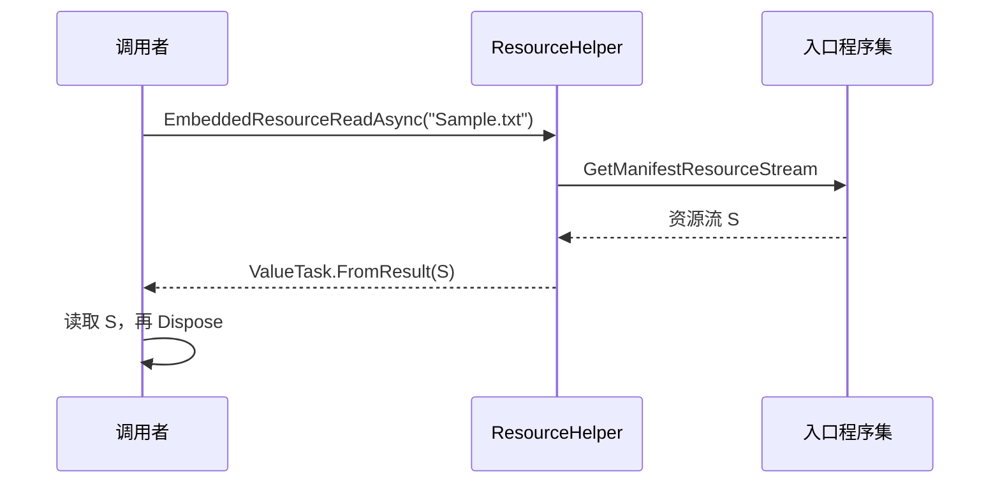

# 跟着一次调用看规格组合、弱缓存扫描和资源读取

## 八个筛选条件，为什么会建七个字典？

从 `Specification<T>.Where` 开始。第一个条件直接赋给 `Criteria`。第二个条件开始，每次调用都要把已有的表达式和新表达式接起来。假设两棵树分别是 `a => a >= 0` 和 `b => b < 100`，目标是得到一棵只有一个形参的树 `a => a >= 0 && a < 100`。右侧树里指向 `b` 的引用必须换成左侧的 `a`。[条件入口](../Specification/Specification.cs#L22)

旧版 `ExpressionCombiner.Compose` 从两个参数列表构造映射，再让访问器遍历右侧表达式。下面是修改前的映射代码。

```csharp
var map = first.Parameters
    .Select((f, i) => new { f, s = second.Parameters[i] })
    .ToDictionary(p => p.s, p => p.f);
```

`Where` 和 `OrWhere` 接受的都是 `Expression<Func<T, bool>>`，所以这里每个字典始终只有一项：右侧的参数对象 → 左侧的参数对象。新版直接调用已有的 `PredicateBuilder.And` 或 `Or`。访问器记住这两个对象，按引用匹配并替换。`AndAlso` 和 `OrElse` 节点仍保留短路语义，树可以继续交给查询提供方翻译。[组合调用](../Specification/ExpressionCombiner.cs#L10) · [两个参数如何传给访问器](../Linq/PredicateOperator.cs#L54) · [引用匹配](../Linq/PredicateOperator.cs#L29)

```diff
-    => left.Compose(right, Expression.AndAlso);
+    => left.And(right);
```

基准交替追加下界和上界，共调用八次 `Where`。第一项直接保存，后七项都参与组合，因而省去了七个单项字典及其构建过程。基准单独计量组树，随后才编译谓词并验证 50 命中、−1 和 100 不命中。嵌套 lambda 的回归还检查了内层对外层参数的引用，以及左侧条件为假时右侧不会求值。[基准输入](../../../benchmarks/MS.Microservice.Core.Benchmarks/QueryCases.cs#L9) · [参数与短路回归](../../../test/MS.Microservice.Core.Tests/Specification/SpecificationTests.cs#L59)

## 扫 1024 个缓存项，需要读多少次时钟？

`DoWeakEviction` 遍历非线程安全缓存。每项记录上次持有强引用的时间 `StrongTime`，成功取用会更新它。扫描活项时，旧版在循环里执行 `DateTime.Now.Subtract(reference.StrongTime)`。扫描已经被 GC 回收的项时，它先把键放入 `toRemove`，结束后再遍历这份列表删除。[取用时恢复强引用](../Memory/WeakEvictionCache.cs#L34) · [刷新时间](../Microsoft/System/StrongToWeakReference.cs#L28)

新版在非空扫描开始时读一次时钟，之后所有项相对同一个 `now` 判断。对 1024 个活项，一轮从 1024 次读时钟变成 1 次；若某项恰在本轮扫描途中达到阈值，下次扫描才会将它弱化。两个版本都需要检查全部 1024 项。[单轮时间点](../Memory/WeakEvictionCache.cs#L44) · [阈值比较](../Memory/WeakEvictionCache.cs#L52)

```diff
-if (DateTime.Now.Subtract(reference.StrongTime) >= _weakEvictionThreshold)
+else if (now - reference.StrongTime >= _weakEvictionThreshold)
```

假设缓存的键 1、2 对应的对象已被回收，键 3 对应的对象仍由调用者持有。当前 .NET 的 `Dictionary.Remove` 允许在同一次枚举中删除键。新版在看到空目标时直接删除 1 和 2，省掉临时列表及第二遍遍历。即使 1024 项全部存活，也省去了旧版每轮创建的空列表。活项到期只撤去强引用，外部仍持有对象时依然可以取回。回归测试确认 1、2 都可重新加入，3 仍返回原对象。[就地删除](../Memory/WeakEvictionCache.cs#L50) · [死项与活邻项测试](../../../test/MS.Microservice.Core.Tests/Memory/WeakEvictionCacheTests.cs#L71)

## 返回资源流时，谁负责释放？

`EmbeddedResourceReadAsync("Sample.txt")` 通过入口程序集和路径拼出资源名。旧版打开资源流，将全部字节复制到 `MemoryStream`，再返回这份副本。关键在 `using` 的作用域。

```csharp
using MemoryStream memoryStream = new();
await resourceStream.CopyToAsync(memoryStream);

return memoryStream;
```

执行 `return` 时会退出这个作用域，`using` 随即释放 `memoryStream`。调用者拿到的就是刚刚关闭的对象，开始读取就会触发 `ObjectDisposedException`。即使只删掉这条 `using`，复制完毕的游标也已到末尾。程序集本来就能为每次查找提供从资源起点开始的流，可以把它直接交给调用者并让调用者释放。[获取并交出原始流](../Common/ResourceHelper.cs#L25)



图中的 S 从程序集一直传到调用者，方法省去了整份资源的复制和副本缓冲。缺失资源仍返回失败的 `ValueTask`，调用者在 `await` 时收到带资源名的 `ArgumentException`。可用下面的命令校验完整资源内容、两次独立查找的游标和缺失资源的报错时机。[异常返回](../Common/ResourceHelper.cs#L31) · [独立烟测](../../../benchmarks/MS.Microservice.Core.Benchmarks/ResourceCase.cs#L6)

```powershell
dotnet run --project benchmarks/MS.Microservice.Core.Benchmarks -c Release -- --resource-smoke
```

耗时、托管分配和测试环境见[Core 性能验收](../../../docs/validation/CORE-PERFORMANCE/summary.md)。资源流的旧版无法完成读取，用烟测验证修复后的可用性。
