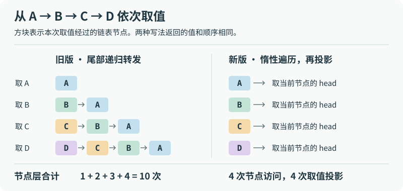

# 对照源码看链表遍历与文本规范化

## 四个节点为什么会执行十次 yield return？

从不可变链表 `A → B → C → D` 调用一次 `AsEnumerable()`，再读完四项。旧版先交出自己的头元素，然后为尾链表建立另一个迭代器。每个内层产生的值，都要经上一层再次交出。

```csharp
// 旧版 AsEnumerable 的非空分支
yield return head!;
foreach (T t in tail!.AsEnumerable())
    yield return t;
```

A 经过一层，B 经过 B、A 两层，到 D 时经过 D、C、B、A 四层。这四项总共执行 `1 + 2 + 3 + 4 = 10` 次自定义 `yield return`。新版把节点的访问顺序交给一个私有惰性迭代器。公开的 `AsEnumerable` 用已有的 `Map` 将节点投影为头元素。每取一个值，私有迭代器交出一个节点，投影取一次值。[节点序列](../Functional/Data/List.cs#L40) · [值的投影](../Functional/Data/List.cs#L35)

```csharp
public IEnumerable<T> AsEnumerable() => NonEmptyNodes().Map(static node => node.head!);
```



读完 1024 项时，旧实现执行 524,800 次自定义 `yield return`，新实现执行 1024 次并投影 1024 个值。私有迭代器只推进局部游标，节点和尾部引用均保持不变。不同枚举器各自记录位置，调用者提前停止时不会访问后续节点。索引器也消费同一节点序列，跳过指定数量后只取第一个节点的 `Head`；负数及越界继续返回 `None`。[索引器](../Functional/Data/List.cs#L31) · [基准用例](../../../benchmarks/MS.Microservice.Core.Benchmarks/CollectionCases.cs)

### ForEach 为什么用 fold，Map 和 Bind 去了哪里？

原来的 `ForEach` 执行 `@this.Map(action.ToFunc())` 后直接返回 `UnitValue`。对于四项，它既执行四次回调，也依照不可变链表 `Map` 的契约构造一条含四个 `Unit` 的新链。调用者只需要回调的效果和单个 `Unit`，可以用左折叠表达这个结果。原有创建新链的 `Map` 和连接多个结果链的 `Bind` 仍供相应场景使用。

```csharp
public static Unit ForEach<T>(this List<T> @this, Action<T> action)
    => @this.Aggregate(UnitValue, (unit, item) =>
    {
        action(item);
        return unit;
    });
```

公开的 `Aggregate` 把种子和归约函数交给 `Fold`。跟进这一层可以看到，它直接对惰性节点序列调用 LINQ 的 `Aggregate`，在归约步骤中取出 `node.head`，避免再单独创建元素投影。空链没有节点，归约函数一次也不会执行，返回的就是种子。[公开入口](../Functional/Data/List.cs#L125) · [节点上的左折叠](../Functional/Data/List.cs#L37)

```csharp
internal Acc Fold<Acc>(Acc seed, Func<Acc, T, Acc> step)
    => NonEmptyNodes().Aggregate(seed, (state, node) => step(state, node.head!));
```

以种子 4、链表 `[1, 2, 3]` 和函数 `(n, x) => 10 * n + x` 为例，累加值依次是 41、412、4123，顺序颠倒会得到不同的值。`Length` 使用同一左折叠，每项给计数加一，长链计数时调用栈深度保持固定。本轮计时覆盖完整枚举和 `ForEach`。回归用例还会在回调里抛出异常，检查遍历随即停止，并验证两个链表仍引用同一个尾部。[计数](../Functional/Data/List.cs#L60) · [长链回调](../../../test/MS.Microservice.Core.Tests/Functional/DataStructuresTests.cs#L15) · [共享尾部测试](../../../test/MS.Microservice.Core.Tests/Functional/DataStructuresTests.cs#L37)

## 一个目录标题为什么会产生多个中间字符串？

用 `TextNormalizer.Normalize` 处理 `"  研发，\t\u00a0“目录”。  "`，预期结果为 `"研发, \"目录\"."`。旧版依次调用 16 次字符替换，再用正则折叠空白，最后调用 `Trim()`。其中 `.Replace('\uFF0C', ',')` 遇到中文逗号会生成一个完整的新字符串，后续的句号、引号和空格替换又要读取前一步的结果。一次替换没有命中时可以复用原串，所以分配次数取决于实际输入。

新版先取去掉两端空白的只读视图。对需要处理的文本，先计算最终长度，再让 `string.Create` 提供最终字符串的可写空间。这个例子首尾空白直接排除，中间的制表符和不换行空格合并为一个普通空格。中文标点与对应的英文标点各占一个 UTF-16 单元。写入时只交付一个完整的结果串。[长度计算和写入](../Common/TextNormalizer.cs) · [字符映射](../Common/TextNormalizer.cs#L53)

像 `readme.md` 或 `chapter one` 这样的标题还可以更早返回。在已经去掉两端空白的视图里，若所有字符都落在可打印 ASCII 范围，且没有两个相邻的空格，就没有标点或空白需要重写。此时只在首尾确实经过裁剪时才生成新字符串。长中文标题走完整的字符检查，基准分别测了 4096 个 ASCII 字符和 4096 个汉字。[ASCII 判断](../Common/TextNormalizer.cs#L16)

```csharp
char normalized = NormalizeCharacter(character);
if (normalized == ' ' && written > 0 && destination[written - 1] == ' ')
    continue;
destination[written++] = normalized;
```

两个边界会影响结果。传入全部由空白组成的字符串时，现有接口要求保留原值。对于混合文本，U+2003 属于可折叠空白，而 U+200B 零宽空格需要保留。表情的两个 UTF-16 单元也要原样写回。对应断言覆盖了这几类字符。[Unicode 回归](../../../test/MS.Microservice.Core.Tests/Common/TextNormalizerTests.cs#L10)

基准把输入构造放在计时区外，分别检查原样文本、混合文本和长标题。链表测量也先构造好节点，再通过公开方法累计相同的整数。全部结果、输入规模和测量口径见[Core 性能验收](../../../docs/validation/CORE-PERFORMANCE/summary.md)。
