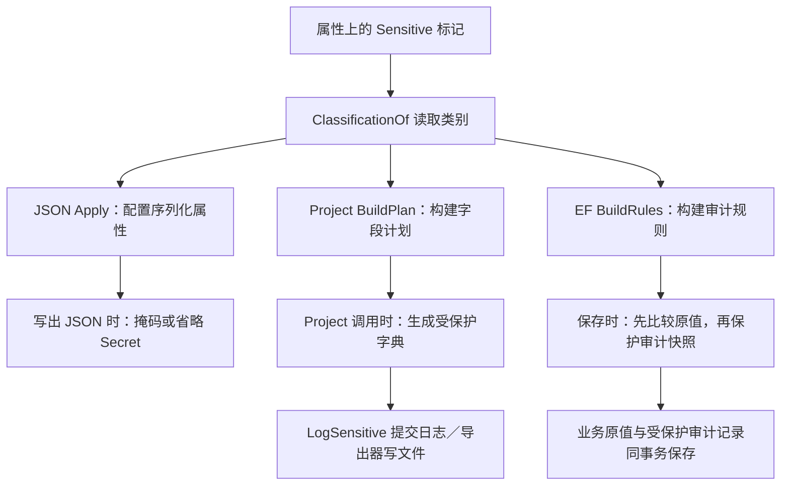
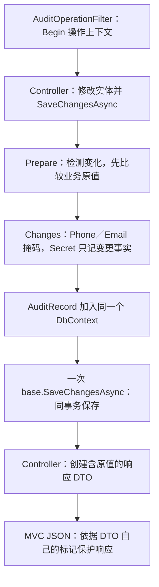

# 敏感字段的注册、扫描与执行链

本文面向维护者，说明字段分类如何进入 JSON、日志／导出及 EF 审计，以及每条路径何时识别标记、何时处理值。接入代码和使用限制见 [Core README](../README.md#敏感字段)，接口体验见 [Lab README](../../../samples/Lab/MS.Microservice.Lab/README.md#敏感字段示例)。

## 职责与数据流

`[Sensitive]` 是属性上的分类元数据。`ClassificationOf()` 负责读取分类，`Protect()` 负责处理一个字符串；各适配器决定何时调用规则。它们位于 [SensitiveValues.cs](../Security/SensitiveData/SensitiveValues.cs)。业务对象、输入和业务表保留原值，受保护的响应、日志、导出和审计快照在各自的输出边界生成。

当前没有统一的 `AddSensitiveData()` 服务注册，也没有启动时扫描所有程序集。HTTP 需要启用 JSON 适配，日志／导出需要调用对应入口，审计需要接入审计 Context。仅引用 Core 或给属性加标记，不会使所有输出自动受保护。

| 路径 | 接入位置 | 扫描范围与时机 | 复用内容与执行时机 |
| --- | --- | --- | --- |
| MVC JSON | `AddControllers().AddJsonOptions(...UseSensitiveValues())` | 解析器构建对象类型的 `JsonTypeInfo` 时读取公开实例属性标记；首次序列化或反序列化都可能触发 | 类型元数据由 System.Text.Json 管理；输出时调用受保护读取委托 |
| 日志／导出投影 | 显式调用 `LogSensitive()`／`Project()`，无需额外 DI 服务 | `Project()` 首次需要某个实际类型的字段计划时读取属性标记 | `Plans` 按运行时 `Type` 缓存字段与 getter；每次调用读取当前值并创建新字典 |
| EF 审计 | `AuditedDbContext`、`AddAuditRecords()`、`AuditChanges(...)` 和操作上下文 | 首次访问 `Plan` 时遍历 EF 模型，只读取选入审计的字段标记 | `Rules` 按 `IModel` 缓存字段分类；每次保存按规则处理实际变化 |

缓存保存元数据和读取方法，不保存业务对象的字段值。实体映射成 DTO、匿名对象或字典时，属性标记不会随数据自动转移；响应 DTO 必须声明自己的分类。

## 公共规则

`SensitiveAttribute` 只用于属性，分类是 `Phone`、`Email` 或 `Secret`。`ClassificationOf(MemberInfo)` 通过属性反射读取分类，不按字段名称或字符串内容自动判断是否敏感。

`Protect(string?, SensitiveKind)` 的处理如下：

| 分类 | 输出规则 |
| --- | --- |
| Phone | 支持 8–15 位数字和可选前导 `+`；保留首三字符与末四字符，中间用等长星号替换 |
| Email | 保留本地部分首个 Unicode 标量及 ASCII 域名，例如 `a***@example.com` |
| Secret | 返回 `null`；适配器负责省略字段或仅保留变更事实 |

Phone／Email 的 `null` 和空字符串保持为空，未识别格式整体替换为 `[REDACTED]`。这些规则不是完整的电话／邮箱验证器，掩码也不对低熵数据提供匿名化保证。Phone／Email 标记必须用于字符串属性，适配器在构建对应元数据时拒绝错误类型。

## HTTP JSON：注册解析器，写出时处理

实现入口是 [SensitiveJson.UseSensitiveValues 与 Apply](../Security/SensitiveData/SensitiveJson.cs)。`JsonTypeInfo` 描述一个类型如何序列化，包括属性名及读取／写入委托；modifier 是元数据构建后执行的修改回调。

1. 宿主在 MVC 的 `JsonSerializerOptions` 上调用 `UseSensitiveValues()`。它给现有类型解析器追加 `Apply`，没有在注册时扫描整个应用。
2. 解析器需要某个对象类型的元数据时，`Apply()` 遍历公开实例属性，通过 `ClassificationOf()` 读取标记，并按照 `JsonPropertyName` 或命名策略找到相应 JSON 属性。
3. Phone／Email 的 JSON getter 被包装成“读取原值，再调用 `Protect()`”。Secret 的 JSON getter 改为空，同时令 `ShouldSerialize` 返回 false，写出时不读取原始 Secret getter。
4. MVC 序列化 `Ok(dto)` 等结果时，执行上述读取委托，形成受保护响应。类型元数据可以复用，字段值每次重新读取。

修改的是序列化元数据中的 getter，并没有给业务属性赋掩码。setter 保留，因此请求反序列化仍接收原值。嵌套对象由 System.Text.Json 按其类型元数据继续处理，其属性也需要声明分类；这与 `Project()` 的扁平投影不同。

Lab 在 [PlatformWebHost.AddServices](../../../samples/Lab/MS.Microservice.Lab/Hosting/PlatformWebHost.cs#L127) 注册这一适配。其效果限于使用该 MVC 配置的序列化路径。独立的 `JsonSerializerOptions`、Minimal API 的其他 JSON 配置、自定义 converter、手工生成的 JSON 都不能据此假定已受保护。

## 日志与导出：共享扁平投影

### Project 的扫描与执行

`SensitiveValues.Project(value)` 使用 `value.GetType()` 查找 `ConditionalWeakTable<Type, Field[]>` 中的字段计划；需要构建时执行 `BuildPlan()`：

1. 从 [PropertyAccessors.Get](../Reflection/PropertyAccessors.cs#L56) 取得属性访问器，保留公开可读属性。
2. 读取分类，检查 Phone／Email 的字符串约束，保存字段名、编译 getter 和分类。
3. 计划包含普通标量及 Secret 字段；导航／嵌套对象不展开。后续投影复用计划，不在每个字段输出时重新反射分类。

每次投影创建新字典，Secret 字段直接跳过，连 getter 都不读取；其他字段读取当前值，有分类的调用 `Protect()`，未标记的标量原样保留。原对象不被修改，未标记字段也不会被自动识别为个人信息。投影保留 CLR 字段名，不依赖 MVC 的 JSON 命名策略。

### 日志提交顺序

[SensitiveLogExtensions.LogSensitive](../Security/SensitiveData/SensitiveLogExtensions.cs) 先检查 `ILogger.IsEnabled`，关闭的级别直接返回；启用时调用 `Project()`，再用受保护字典构建 `ProtectedState` 提交给 `ILogger`。状态和 formatter 不持有原 DTO，NLog、Serilog 或异步日志队列收到的已是处理结果。

`eventName` 必须来自固定、可信的业务事件名，不能拼入用户数据。普通 `LogInformation`、已有日志内容和异常文本不经过这个入口，不会被后置扫描。现有 ILogger 注册即可承载该扩展，无需额外注册敏感字段日志 provider。

### 导出执行顺序

导出调用方先执行 `Project()`，再把字典交给 CSV／Excel。导出器不负责扫描标记。Lab 的 `Export()` 在投影之后对电子表格公式文本做转义，再写 CSV；字段脱敏与公式转义承担不同责任。直接把原 DTO 传给未适配的导出器不受保护。

## EF 审计：比较原值后生成受保护快照

### 注册与规则发现

审计需要两层接入：

- HTTP 操作身份：[AddAutomaticAuditOperations](../../MS.Microservice.AspNetCore/Auditing/AuditOperationFilter.cs#L21) 注册 scoped `AuditOperationContext` 和 MVC 过滤器。过滤器读取当前 endpoint 的 `[AuditOperation]`，从可信身份取得 Scope／Actor 并调用 `Begin()`；没有标记则直接继续，无法解析身份则拒绝执行。它不扫描请求字段的 `[Sensitive]`。非 MVC 工作流由宿主显式建立操作上下文。
- EF 模型与保存：[SensitiveDemoContext](../../../samples/Lab/MS.Microservice.Lab/Application/Tools/SensitiveDataDemo.cs#L8) 继承 `AuditedDbContext`，在模型中调用 `AddAuditRecords()` 映射审计表，再用 `AuditChanges(...)` 选择字段。实体上的 `[Sensitive]` 决定这些字段的快照保护方式。

[AuditModelExtensions.AuditChanges](../../../MS.Microservice.Persistence/src/MS.Microservice.Persistence.EFCore/Auditing/AuditModelExtensions.cs#L12) 在模型构建时解析字段表达式，将所选属性名写入 EF annotation。[AuditedDbContext.BuildRules](../../../MS.Microservice.Persistence/src/MS.Microservice.Persistence.EFCore/Auditing/AuditedDbContext.cs#L161) 在首次需要 `Plan` 时读取这些 annotation，扫描入选字段的属性分类，构建 `IProperty → SensitiveKind` 映射，并按 `IModel` 缓存。

首次 `Plan` 访问既可能由查询实体的跟踪事件触发，也可能来自 `SaveChanges` 的 `Prepare()`。后续保存复用模型规则，不重新扫描全部实体属性。未选入 `AuditChanges` 的字段不参与采集。

### 保存与响应是两条独立路径

`Prepare()` 检查 ChangeTracker 中的新增、修改、删除，只采集入选字段。对已知原值的修改先比较 `OriginalValue` 与 `CurrentValue`，然后 `Changes()` 才保护快照。因此手机号从 `13800138000` 改为 `13899118000`，即使都输出 `138****8000`，仍然产生审计变化。

Phone／Email 写入 `protection=Masked`，已有的前后值分别经过 `Protect()`；Secret 写入字段名、`beforeKnown` 和 `protection=ChangedOnly`，省略所有前后值。附加更新无法证明旧值时使用 `beforeKnown=false`，不会额外查库或伪造旧值。

每个存在入选字段变化的实体产生一条 `AuditRecord`，同次保存共享操作 ID 和保存序号；记录加入业务 Context 后，只调用一次底层 EF 保存，业务数据和审计记录一起提交。采集或保存失败会移除暂存审计记录并传播错误，自动变更检测开关和保存标记在结束时恢复。这个保证覆盖同一次 `SaveChanges`；多次保存若要整体原子性，仍需宿主显式事务。完整事务与失败约束见 [自动审计设计](../../../MS.Microservice.Persistence/docs/automatic-auditing.md)。

业务表和跟踪原值不被掩码替换。响应通过 DTO 自己的 JSON 标记另行保护；查询审计时读取的是已经保护的 `ChangesJson`，不是取出原值再靠 HTTP 输出遮盖。JSON 注册不启用 EF 审计，EF 审计也不替代 JSON 注册。

敏感主键在规则构建时被拒绝，避免原值通过 `ResourceId` 泄漏。普通 DbContext、原生 SQL、`ExecuteUpdate`／`ExecuteDelete` 等绕过此跟踪保存路径的操作不被采集；缺少操作上下文、无效审计模型或超出采集预算会使审计保存失败。

## Lab 的代码阅读入口

沿下表可从宿主注册一直定位到执行位置；接口调用步骤保留在 [Lab README](../../../samples/Lab/MS.Microservice.Lab/README.md#敏感字段示例)。

| 环节 | 代码入口 | 观察重点 |
| --- | --- | --- |
| 注册 JSON 与 HTTP 操作上下文 | [PlatformWebHost.AddServices](../../../samples/Lab/MS.Microservice.Lab/Hosting/PlatformWebHost.cs#L127) | `UseSensitiveValues()` 与 `AddAutomaticAuditOperations(...)` 分别负责输出和操作身份 |
| 注册示例数据库 | [AddSensitiveDataDemo](../../../samples/Lab/MS.Microservice.Lab/Application/Tools/SensitiveDataDemo.cs#L31) | `AddDbContext` 与初始化器；该方法只组装示例存储，不是全局敏感字段扫描器 |
| 选择审计字段及实体分类 | [SensitiveDemoContext.OnModelCreating／SensitiveDemoEntity](../../../samples/Lab/MS.Microservice.Lab/Application/Tools/SensitiveDataDemo.cs#L12) | `AuditChanges` 的选择与实体上的三个分类 |
| 请求／响应 DTO 分类 | [SensitiveDemoRequest／SensitiveDemoView](../../../samples/Lab/MS.Microservice.Lab/Controller/SensitiveDataToolsController.cs#L16) | Request、实体、View 各自声明标记；View 映射不会继承实体标记 |
| JSON、日志与投影预览 | [Preview](../../../samples/Lab/MS.Microservice.Lab/Controller/SensitiveDataToolsController.cs#L39) | 同一请求对象分别送入 `LogSensitive`、`Project` 和 MVC JSON 输出 |
| CSV 导出 | [Export](../../../samples/Lab/MS.Microservice.Lab/Controller/SensitiveDataToolsController.cs#L48) | 先投影，再生成表头、单元格并写文件 |
| 业务写入与审计 | [Create／Update](../../../samples/Lab/MS.Microservice.Lab/Controller/SensitiveDataToolsController.cs#L59) | `[AuditOperation]`、原值赋给实体、保存、返回 View |
| 查看记录与审计 | [Get／Audit](../../../samples/Lab/MS.Microservice.Lab/Controller/SensitiveDataToolsController.cs#L80) | 业务记录返回 View 后脱敏；审计返回已保护的快照 |

以创建接口为例，`Apply(row, request)` 先把原值复制给实体，`SaveChangesAsync()` 将原值写入业务表、保护后的快照写入审计表，`View(row)` 仍包含原值；最后 MVC 按 `SensitiveDemoView` 上的分类写出掩码。原值保留、审计落盘保护和响应输出保护分别发生在这几个位置。

## 实现取舍与边界

按输出入口接入，使规则不依赖具体日志后端或导出器，也避免在业务实体上反复改写字段。代价是每条输出路径都必须明确接入，不能把标记理解为全局拦截。数据库加密、完整值访问授权、密钥管理仍由宿主负责；完整值输出应通过独立授权的 DTO／入口提供，不能允许请求任意关闭保护。

投影复用运行时编译 getter，JSON 和审计通过反射读取分类。这些适配路径尚未通过 Native AOT／裁剪验收；纯标量 `Protect()` 不依赖属性扫描。首次投影包含字段计划和访问器编译，热路径结果不能代替冷启动耗时。[性能记录](../../../docs/components/cache-sensitive-performance.md)区分标量、投影、JSON、日志和 SQL 前审计采集，且不包含存储或日志后端 I/O。
