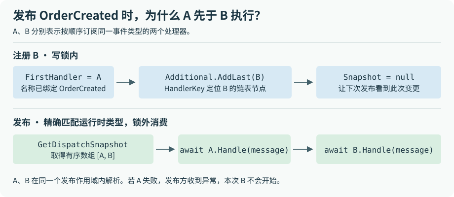

# 从订阅索引跟到 Handle

早期实现只需回答“这个名称绑定哪个 CLR 类型”。进程内消费还要回答“给定这个事件对象，应该按什么顺序调用哪些处理器”。两条查询共用一个订阅管理器，各自读取不同的信息。

## 同一份注册如何支持两种查询

基线 `39a704c` 为每个新名称创建一个处理器 `HashSet`，再用另一张字典保存事件类型。以下是旧版的关键语句。

```csharp
handlerTypes = [];
_handlerTypesByEventName[eventName] = handlerTypes;
// ……添加处理器并检查重复……
_eventTypesByName.TryAdd(eventName, typeof(TEvent));
```

上轮优化把首个处理器直接存入名称条目，额外的处理器用共享集合去重，并让按名称查类型走并发字典。今天的实现沿用首项内联和名称查询路径，还为每个处理器记下注册用的真实事件类型、处理器类型和调用委托。[名称查询](../InMemoryEventBusSubscriptionsManager.cs#L70) · [注册描述符](../InMemoryEventBusSubscriptionsManager.cs#L92)

以 `OrderCreated` 为例。先订阅 A、再订阅 B 时，`FirstHandler` 保存 A，`Additional` 的末尾追加 B。共享字典 `_additionalHandlers` 以 `HandlerKey(首次绑定的事件类型, B 的处理器类型)` 定位列表节点。注销 B 时，用键取出节点后直接从链表摘除。注册和注销都在 `_writes` 锁内修改成员，使本条目的旧分派快照失效。单处理器事件无需为额外成员创建链表。[追加处理器](../InMemoryEventBusSubscriptionsManager.cs#L34) · [按节点注销](../InMemoryEventBusSubscriptionsManager.cs#L58)



## 同样叫 Changed，查类型和执行处理器会看到什么？

两个模块可能分别定义 `Sales.Changed` 和 `Stock.Changed`。假设 A 订阅前者，B 订阅后者。旧 API 使用区分大小写的 CLR 短名作为键，名称绑定持续到该名称的最后一个订阅被移除。发布对象则按实际 CLR 类型与每个注册描述符精确匹配。[名称的绑定规则](../../../test/MS.Microservice.EventBus.Tests/SubscriptionLifecycleTests.cs#L9) · [实际对象的分派测试](../../../test/MS.Microservice.EventBus.Tests/InMemoryEventBusTests.cs#L100)

| 已执行的操作 | 按名称查询 `"Changed"` | 发布 Sales.Changed | 发布 Stock.Changed |
| --- | --- | --- | --- |
| 注册 Sales.Changed / A | Sales.Changed | 执行 A | 无匹配 |
| 再注册 Stock.Changed / B | Sales.Changed | 执行 A | 执行 B |
| 注销 A | Sales.Changed | 无匹配 | 执行 B |
| 注销 B | null | 无匹配 | 无匹配 |
| 再注册 Stock.Changed / B | Stock.Changed | 无匹配 | 执行 B |

第三行解释了为什么不能拿 `GetEventTypeByName("Changed")` 做消费分派：按名查到的仍然是 Sales 类型，此时唯一的活跃订阅却要消费 Stock 类型。重复注册和注销沿用原来的短名与处理器类型规则。即使处理器声明为 `IIntegrationEventHandler<IntegrationEvent>`，它也只接收通过 `Subscribe<TEvent, THandler>()` 订阅的那个事件类型。

## 一次 PublishAsync 在哪里真正调用了 Handle？

`GetDispatchSnapshot` 先按名称找到条目，再检查已发布的快照是否属于同一实际事件类型。命中时直接使用已构造的数组。未命中时进入写锁，重新检查名称绑定，先看首处理器，再遍历额外处理器链表，保留事件类型匹配的描述符。每个名称条目缓存最近一次有匹配项的类型快照；交替发布同短名的不同类型时，可能需要重新筛选。[读取快照](../InMemoryEventBusSubscriptionsManager.cs#L112) · [按真实类型筛选](../InMemoryEventBusSubscriptionsManager.cs#L127)

`PublishAsync` 拿到快照之后，在锁外创建 DI 作用域，并按数组顺序逐个等待：

```csharp
await using var scope = scopes.CreateAsyncScope();
foreach (var handler in handlers)
    await handler.Invoke(scope.ServiceProvider, @event).ConfigureAwait(false);
```

`Invoke` 来自订阅时绑定的泛型委托，实际执行 `services.GetRequiredService<THandler>().Handle((TEvent)message)`。因此快照保存的是注册描述，具体处理器由本次发布的作用域解析。在 A 执行期间退订 B，本次快照仍保留 B；下次发布会看到退订。若 A 失败，异常向发布者传播，后面的 B 不会开始。[消费循环](../InMemoryEventBus.cs#L28) · [调用 Handle 的一行](../InMemoryEventBusSubscriptionsManager.cs#L99)

## Clear 与正在进行的查询或消费

按名查询先取一次当前表引用：已经取得旧表的读者与 `Clear()` 重叠时仍可读到旧类型。清空完成后才开始的新查询，在重新注册前返回 `null`。同理，已经拿到分派数组的发布可以完成本次投递。逐项注销后集合可能保留已申请的容量；清空会释放管理器对索引的引用，仍被读者或发布任务持有的数据由其生命周期决定。[清空索引](../InMemoryEventBusSubscriptionsManager.cs#L78) · [并发回归](../../../test/MS.Microservice.EventBus.Tests/SubscriptionLifecycleTests.cs#L85)

此前的性能对照覆盖注册、注销、清空和按名查类型。当时只有订阅索引；其 15 组历史数字没有计入新增的有序列表、快照构造、DI 解析及业务处理耗时。可运行示例和历史输入分别见[端到端消费示例](../samples/basic-usage.md)与[订阅基准验收](../../../docs/validation/EVENTBUS-SUBSCRIPTIONS/summary.md)。
