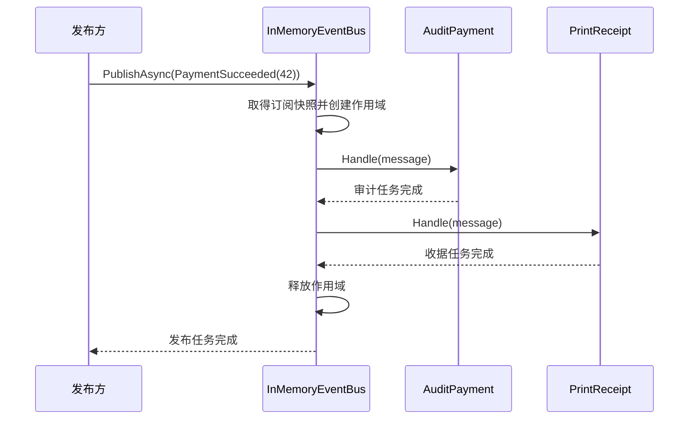

# 跟着一次发布找到业务消费者

下面的 .NET 11 控制台示例发布两笔付款。第一笔有两个订阅者，记入审计记录后打印收据。第二笔发布前退订收据处理器，所以只有审计处理器执行。项目需要引用 `MS.Microservice.EventBus` 和 `Microsoft.Extensions.DependencyInjection`。

```csharp
using Microsoft.Extensions.DependencyInjection;
using MS.Microservice.EventBus;
using MS.Microservice.EventBus.Abstractions;
using MS.Microservice.EventBus.Events;

var services = new ServiceCollection();
services.AddInMemoryEventBus();
services.AddScoped<PaymentWork>();
services.AddScoped<AuditPayment>();
services.AddScoped<PrintReceipt>();
await using var provider = services.BuildServiceProvider();

var bus = provider.GetRequiredService<IEventBus>();
bus.Subscribe<PaymentSucceeded, AuditPayment>();
bus.Subscribe<PaymentSucceeded, PrintReceipt>();

await bus.PublishAsync(new PaymentSucceeded(42));
bus.Unsubscribe<PaymentSucceeded, PrintReceipt>();
await bus.PublishAsync(new PaymentSucceeded(43));

public sealed class PaymentSucceeded(int orderId) : IntegrationEvent
{
    public int OrderId { get; } = orderId;
}

public sealed class PaymentWork
{
    public List<int> AuditedOrderIds { get; } = [];
}

public sealed class AuditPayment(PaymentWork work) : IIntegrationEventHandler<PaymentSucceeded>
{
    public async Task Handle(PaymentSucceeded message)
    {
        await Task.Yield();
        work.AuditedOrderIds.Add(message.OrderId);
        Console.WriteLine($"Audited {message.OrderId}, count {work.AuditedOrderIds.Count}");
    }
}

public sealed class PrintReceipt(PaymentWork work) : IIntegrationEventHandler<PaymentSucceeded>
{
    public Task Handle(PaymentSucceeded message)
    {
        Console.WriteLine($"Receipt {message.OrderId}, audited {work.AuditedOrderIds.Contains(message.OrderId)}");
        return Task.CompletedTask;
    }
}
```

输出如下：

```text
Audited 42, count 1
Receipt 42, audited True
Audited 43, count 1
```

`AuditPayment.Handle` 中的 `Task.Yield()` 刻意让第一次调用异步挂起。总线等待它把 42 写入 `PaymentWork`，然后才调用 `PrintReceipt.Handle`。收据能读到 42，说明两个处理器拿到了同一作用域的 `PaymentWork`。订单 43 的计数重新从 1 开始，因为这次发布建立了新的作用域。



若审计处理器抛出异常，本次收据处理器不会执行，调用方在 `await bus.PublishAsync(...)` 处观察到失败。订阅快照一旦取得，期间发生的订阅变更只影响之后取得的快照。
