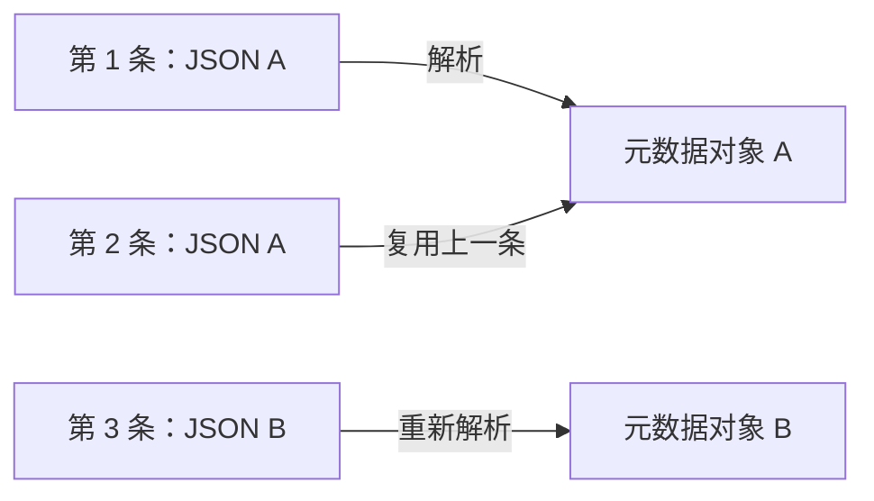

# 对照源码看事件回放中的重复反序列化

`src/MS.Microservice.EventSourcing` 的两个生产源码文件定义事件、元数据、信封、存储、快照、检查点及分页读取契约。Lab 把 `IEventStore` 和 `IEventBatchReader` 注册到同一个作用域内的 `PostgresEventStore`。读取数据库和构造信封的成本发生在这个适配器中。[存储契约](../EventSourcingAbstractions.cs) · [分页契约](../IEventBatchReader.cs) · [Lab 注册](../../../samples/Lab/MS.Microservice.Lab.Infrastructure/EventSourcing/Microsoft/Extension/DependencyInjection/EventSourcingServiceCollectionExtensions.cs)

## 同一个请求连续写入三条事件，会解析几次元数据？

假设读取三条订单事件，每条的正文不同，前两条来自同一个请求。数据库返回的 `Metadata` 是 JSON 文本，前两条内容相同（记为 A），最后一条是 B。每条对应不同的 `EventId`、版本和正文，仍要创建三个完整的 `EventEnvelope<TEvent>`。真正可以减少的是 JSON 元数据的解析次数。

旧版把记录列表交给 LINQ `Select(Map<TEvent>)`，在每次 `Map` 单条记录时都做这两次反序列化。相邻记录的 `Metadata` 即使逐字符相同，A 也会被独立解析两次。

```csharp
// 旧版 Map<TEvent>(EventStoreRecord record)
var @event = _serializer.Deserialize<TEvent>(record.EventType, record.Payload);
var metadata = _serializer.DeserializeMetadata(record.Metadata);
```

新版 `Map<TEvent>` 在一次读取的循环中保存上一条的 JSON 和解析出的元数据，直接填充按记录数分配的结果数组。正文仍逐条按已注册事件类型反序列化。下面摘出判断，`record.Metadata != previousJson` 比较字符串内容，不要求它们是同一个字符串对象。[映射实现](../../../samples/Lab/MS.Microservice.Lab.Infrastructure/EventSourcing/Repository/PostgresEventStore.cs#L126)

```csharp
if (!_serializer.UsesDefaultOptions || metadata is null || record.Metadata != previousJson)
{
    metadata = _serializer.DeserializeMetadata(record.Metadata);
    previousJson = record.Metadata;
}
```



三条只解析两次。若 1024 条事件每连续 32 条同属一个请求，各组的元数据不同，只需解析 32 次。如果每一条元数据都不同，仍需 1024 次解析，多做的只是相邻字符串比较。相同字段但空格、属性顺序不同的 JSON 也会分别解析。输入文本保持原样，数据库提供程序怎样格式化 JSON 都适用这个判断。[六种读取输入](../../../benchmarks/MS.Microservice.EventSourcing.Benchmarks/Program.cs)

## 为什么只在默认选项下复用？

`EventMetadata` 是只含字符串和整数的 sealed record，字段只允许初始化。默认序列化器产生的对象可以安全地由相邻信封共享。缓存只覆盖这一次读调用中的上一条记录，再次查询时从头判断。显式传入 `JsonSerializerOptions` 时，用户转换器可能计数或基于外部状态返回不同的元数据，代码保留逐条调用。[序列化选项](../../../samples/Lab/MS.Microservice.Lab.Infrastructure/EventSourcing/Serialization/SystemTextJsonEventSerializer.cs) · [每条调用自定义转换器的回归](../../../test/MS.Microservice.Lab.Tests/Infrastructure/EventSourcing/OrderReadModelProjectorPersistenceTests.cs#L72)

`LoadStreamAsync` 按流版本升序返回，包含指定起始版本。`ReadAllAsync` 返回游标之后的全部匹配项，分页接口才使用 `Take(take)`。例如位置 1、3、4 属于订单，位置 2 属于另一种流，读取两条订单返回 1 和 3，下一页的游标应为 3。现有 SQLite 测试记录实际执行的 SQL，断言分页携带 LIMIT，并用该组输入核对结果和跟踪状态。[单流入口](../../../samples/Lab/MS.Microservice.Lab.Infrastructure/EventSourcing/Repository/PostgresEventStore.cs#L24) · [分页入口](../../../samples/Lab/MS.Microservice.Lab.Infrastructure/EventSourcing/Repository/PostgresEventStore.cs#L47) · [读取边界测试](../../../test/MS.Microservice.Lab.Tests/Infrastructure/EventSourcing/OrderReadModelProjectorPersistenceTests.cs#L41)

本次还试过边读边解析 JSON 并直接填结果列表。这个方案能少一部分托管分配，但实测全历史读取的耗时上升，最终保留了先读完一页、关闭 reader、再解析的顺序。全历史读取仍会占用随结果条数增长的内存。基准用内存 SQLite 比较同一 Lab 适配器，测量和验收边界见[完整对照](../../../docs/validation/EVENTSOURCING-EXCEL-PERF/summary.md)。
