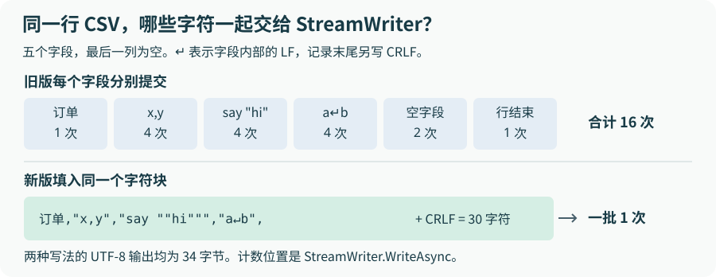

# 从 `CsvHelper.WriteAsync` 看 CSV 的写入成本

## 一行已经合成一次写入，为什么还要改行尾？

让 `WriteAsync` 导出 1024 行，每行只有一个字段 `x`，用默认的 `\r\n` 结束。每行占用工作区 `block` 的 3 个位置，整个文件占 3072 个，能装进一个容量为 4096 的字符块。在 `32c9bfa` 中，行尾的最后一句让这个工作区每次只能攒到 3 个字符。

```csharp
// 改动前，每写完一行都走到这里
options.NewLine.CopyTo(0, block, used, options.NewLine.Length);
used += options.NewLine.Length;
await WriteBlockAsync().ConfigureAwait(false);
```

跟进 `WriteBlockAsync()` 就能看到它的成本。它记下 `count = used`，把 `used` 归零，然后调用 `writer.WriteAsync(block.AsMemory(0, count), cancellationToken)`。于是下一行又从 `block[0]` 开始。`Memory` 只是指向数组的一个区间，同一个数组已经在复用。这里能省的是反复进入 `StreamWriter.WriteAsync` 的次数。

```csharp
// 改动后，行结束符也留在 block 里
options.NewLine.CopyTo(0, block, used, options.NewLine.Length);
used += options.NewLine.Length;
if (used == WriteBlockSize) await WriteBlockAsync().ConfigureAwait(false);
```

循环结束后另有一次 `await WriteBlockAsync()` 提交尾块。如果下一段字段内容或行结束符放不下，循环内部也会先交出已经填好的部分。对这 1024 行而言，`used` 依次是 3、6、9，最后到 3072，成功枚举完才提交一次。对于装不满一块就结束的短文件，漏掉最后这次提交会丢掉全部内容。[提交行结束符与尾块](../CsvHelper.cs#L252) · [`WriteBlockAsync` 提交有效前缀](../CsvHelper.cs#L295)



`block` 负责把 CSV 字段拼成连续的字符。下一层 `StreamWriter` 有自己的字符缓冲区，会按配置的编码把字符写入目标 `Stream`。示例中的 **1024 → 1** 只统计两层之间的调用。把计数器放在目标流上重测，两版都只收到 **1 次写入，共 3072 字节，另有 2 次刷新**。`StreamWriter` 已把旧版的小片段合并起来。两次刷新分别出现在成功结束时显式调用 `FlushAsync` 和随后释放 writer 时。[目标流测量](../../../docs/validation/CSV-WRITE-BLOCKS/summary.md)

中途失败时，已经交给写入器的前缀可能输出，仍在 `block` 里的尾部可能丢弃。需要每行及时可见的接口，要把刷新时机单独列入契约。[CSV 生命周期](csv-design.md#生命周期)

### 再往前看，为什么先要合并一行里的字段？

更早的 `39a704c` 直接在列循环中调用写入器。看这一行，其中 `a` 和 `b` 之间有一个真实换行，末列为空。

```csv
订单,"x,y","say ""hi""","a
b",
```

逐片段写时，第一个字段调用一次，随后三个带引号字段各调用四次（分隔符、开引号、正文、闭引号），末列调用两次（分隔符、空正文），行末再调用一次。合计 `1 + 3 × 4 + 2 + 1 = 16` 次。`32c9bfa` 把同一行连同行末的 30 个字符先拼进了 `block`，降到一次。现在下一行也能继续使用 `block` 的剩余空间。三种写法在这个例子里都输出相同的 34 个 UTF-8 字节。[第一轮对照数据](../../../docs/validation/EVENTSOURCING-EXCEL-PERF/summary.md#excel)

## 自定义分隔符为什么不必每次都建一张查找表？

设 `Delimiter = ';'`，字段是 `a;b`。分号属于正文，要给整个字段加外层引号，写成 `"a;b"`。为了找到这类字段，旧版每次导出都先准备一张待查字符表。

```csharp
var syntax = options.Delimiter == ',' ? CommaSyntax
    : SearchValues.Create([options.Delimiter, '"', '\r', '\n']);
// 每段字段正文再调用 part.ContainsAny(syntax)
```

`CommaSyntax` 是静态字段。逗号路径已经复用它。分号路径每次进入 `WriteAsync` 都执行 `Create`，即使调用者传入上一次的 `CsvOptions`，也要再准备一遍。只导出一个 `a;b` 时，这一固定成本完全由一个字段承担。

自定义分隔符现在从 `GetCustomSyntax` 取表。下面是方法内决定要不要重新建表的三行。`CustomSyntax` 只有 16 个槽位，槽位里放的是表的引用。

```csharp
ref var slot = ref CustomSyntax[delimiter % CustomSyntax.Length];
var syntax = Volatile.Read(ref slot);
if (syntax is null || !syntax.Contains(delimiter))
```

按分隔符的字符值对 16 取余，能算出三种典型输入如何共享这些槽位。

| 分隔符 | 槽位 | 第一次填完后会怎样 |
| --- | ---: | --- |
| 分号 `;` | 59 % 16 = 11 | 再写分号直接取回表，即使传入新建的 `CsvOptions` |
| 竖线 | 124 % 16 = 12 | 与分号交替导出时，两张表各占一槽，可以重复命中 |
| 加号 `+` | 43 % 16 = 11 | 与分号同槽，需要替换成自己的表。下次写分号时重新建表 |

每张表只含当前分隔符、双引号、CR、LF。`Validate` 已排除把后三者用作分隔符的情况，因此遇到同槽的加号时，分号表的 `Contains('+')` 会返回假。一次导出始终持有开始时取得的不可变引用，另一调用替换槽位不影响已经进行的字段判定。这样最多缓存 16 张自定义表，`CsvOptions` 仍可照常用 `with` 复制。长普通字段仍用一次 `part.ContainsAny(syntax)` 查四种字符。[取表与换表](../CsvHelper.cs#L305) · [分隔符校验](../CsvOptions.cs#L14) · [同槽换表的嵌套导出测试](../../../test/MS.Microservice.Excel.Tests/CsvHelperTests.cs#L287)

## 引号多久出现一次，为什么会改变最快的写法？

写正文之前，`WriteAsync` 已经统计了字段里的 `quotes`，用来校验序列化后的长度。值 `a"b` 本身长 3，写成 `"a""b"` 后长 6，其中 2 个位置是外层引号，1 个位置是内嵌引号的副本。第一轮优化已省掉 `value.Replace("\"", "\"\"")` 产生的中间字符串，但原来的转义循环对每个源字符仍然做一次判断。

```csharp
// 改动前，字段内只要有一个双引号，每个字符都这样复制
char c = value[i];
block[used++] = c;
if (c == '"') block[used++] = c;
```

假设连续 255 个 `a` 后才出现一个 `"`。`CopySparseQuotes` 用 `IndexOf('"')` 找到下标 255，把前 256 个字符连同引号一起拷到 `block`，只需再补写一个 `"`。没有下一个引号时，剩余正文也能整段复制。`IndexOf` 仍要搜索正文，省下的是复制这 255 个 `a` 时逐个判断、逐个写出的工作。[跳段复制](../CsvHelper.cs#L329)

```csharp
// CopySparseQuotes 中，每轮处理至下一个引号
while ((quote = source.IndexOf('"')) >= 0)
{
    source[..(quote + 1)].CopyTo(destination[written..]);
    written += quote + 1;
    destination[written++] = '"';
    source = source[(quote + 1)..];
}
source.CopyTo(destination[written..]);
```

如果内容全是引号，每一轮只复制 1 个字符又要找下一处，逐字符双写更直接。没有内嵌引号的字段照常直接复制。有引号的字段用 `quotes <= value.Length / MinCharsPerSparseQuote` 选择 `CopySparseQuotes`，常量 `MinCharsPerSparseQuote` 的值是 16。像 `{"id":42,"ok":true}` 这样的短 JSON，或 `A"中"A"中"` 这样的交替序列，继续用逐字符循环。这里比较的是整个字段里的引号数，不要求这些引号等距分布。[选择转义路径](../CsvHelper.cs#L239) · [逐字符复制](../CsvHelper.cs#L318) · [连续引号和跨块测试](../../../test/MS.Microservice.Excel.Tests/CsvHelperTests.cs#L328)

这个分界来自同机的局部复制对照。每段 2048 个 UTF-16 代码单元，引号等距分布时测得如下。数字只计复制这个片段的时间，完整导出还包括语法扫描、编码和写入。[完整导出与测量条件](../../../docs/validation/CSV-WRITE-BLOCKS/summary.md)

| 引号间隔 | 逐字符判断并复制 | `IndexOf` 跳段复制 |
| --- | ---: | ---: |
| 每 8 个字符一个引号 | 1752 ns | 2141 ns |
| 每 16 个字符一个引号 | 1638 ns | 1231 ns |

## 长字段什么时候能响应取消？

`4096` 是 `char` 的个数，单位是 UTF-16 代码单元。比如 `😀` 在这里占两个位置，编码成 UTF-8 后占四个字节。所有字段都会先扫描，再按内容选择写出路径。

| 正在执行的代码 | 原来的检查 | 现在的检查 |
| --- | --- | --- |
| 扫描字段，决定是否加引号并计算长度预算 | 每扫描至多 4096 个源字符，开始下一段前检查令牌 | 保留原检查 |
| 把含嵌入引号的正文拷入 `block` | 分片已有长度上限，但片内复制前没有显式检查，可能等到下一次异步提交才观察到取消 | 每片开始先 `ThrowIfCancellationRequested()`，每片至多 2048 个源字符 |
| 把无需双写引号的超长正文直接交给 `StreamWriter` | 一次传出整个 `value.AsMemory()` 和令牌 | 沿用整段提交，后续由写入器和底层流执行 I/O |
| 本行写完，准备请求下一行 | 先调用源的 `MoveNext()`，才在循环开头检查取消 | 行末再检查一次，在下一次 `MoveNext()` 之前就能响应取消 |

转义循环为什么最多取 2048？在最坏情况下它们全是引号，双写后刚好填满 4096 个位置。原来就得在这里切片，在同一处检查令牌，可以限制一次本地转义循环连续处理的字符数，又无需为每个字符增加一次判断。[扫描循环](../CsvHelper.cs#L202) · [转义循环](../CsvHelper.cs#L231)

普通字段是否也值得切片，可以用会在第一次写入时触发取消、但忽略传入令牌的目标流来验证。给旧版 `bfa3011` 传入 65,536 个 `x`，或相同数量的双引号，测试中两种输入都能停止，连同清理时可能刷出的尾部，目标流收到的字节均在 8192 以内。在同机 16,384 个 `x` 的可取消导出中，试着在外层每 4096 个字符切一段再提交，耗时从 3.737 µs 增至 4.227 µs，约多 13%。因此保留下面这句，让写入器直接引用整段原文。8192 字节是这组测试的观察上限，正在等待的 I/O 仍受目标流的取消支持限制。[普通正文的直写路径](../CsvHelper.cs#L218) · [两种长字段的取消测试](../../../test/MS.Microservice.Excel.Tests/CsvHelperTests.cs#L470) · [候选方案对照](../../../docs/validation/CSV-WRITE-BLOCKS/summary.md)

```csharp
await writer.WriteAsync(value.AsMemory(), cancellationToken).ConfigureAwait(false);
```

真正能在旧版复现的是行末的顺序问题。一行正好填满 4096 个位置，提交时目标流触发取消，源的下一次 `MoveNext()` 却仍可能执行。如果源会访问数据库或检查取消后是否又有人读取，光在循环开头检查就晚了一步。把 `ThrowIfCancellationRequested()` 放到提交结束、源推进之前，能在调用方继续处理取消时保留原令牌。[行末检查](../CsvHelper.cs#L255) · [下一行不得再枚举的回归测试](../../../test/MS.Microservice.Excel.Tests/CsvHelperTests.cs#L493)

成功或失败退出时，写入器都会清掉租用数组本次写过的位置再归还数组池。[归还工作区](../CsvHelper.cs#L286)

## `ExportCsvAsync` 的每行数组去了哪里？

模型导出另有一层迭代器 `Records()`。原来的 `meta.Slots.Select(...).ToArray()` 会为表头和每条数据行创建新的字段数组。在 256 条记录、2 列的例子里，共有 257 个数组用来存放这些引用。现在先建一份与列数等长的数组，第一次填表头，以后每次按槽位重填模型值。[模型导出](../ExcelHelper.Csv.cs#L87)

```csharp
var fields = new string?[meta.Slots.Length];
for (int i = 0; i < fields.Length; i++) fields[i] = meta.Slots[i].ColumnName;
yield return fields;
```

这份数组只交给同一次调用内部的 CSV 写入器。写入器读完字段后才向迭代器请求下一行，留在 `block` 里的字符已与数组里的引用分离，因而可以安全地覆盖同一个数组。数值、日期生成文本的工作仍然存在。输入仍按需枚举，失败与取消仍会释放枚举器并让调用者保有输出流。对外返回的 `CsvRow.Fields` 则可以被调用者保存，读取端会为各行保留独立字段集合。
