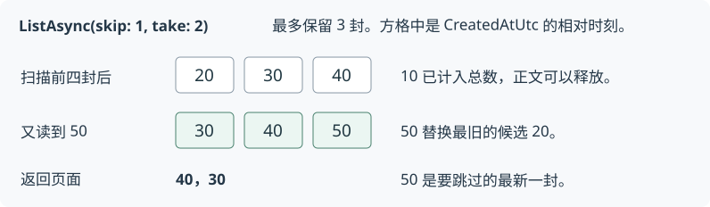

# 收件箱分页和通知模板的性能

一个用户有 128 封通知，打开首页只取 8 封。`ListAsync` 仍得看完 128 封才能回答“总共多少封，还有多少封未读”。旧版在扫描时让这 128 封的正文同时留在内存中，还为每份文件重新准备读取缓冲区。这两笔成本发生在不同位置。[收件箱实现](../Inbox/LocalNotificationInbox.cs)

## 扫描 128 封只保留页面所需的候选

```csharp
// 旧版 ListAsync，每次扫描都加入 List
notifications.Add(notification with { ReadAtUtc = receipt.Time });

// 扫完再选页
notifications.OrderByDescending(item => item.CreatedAtUtc)
    .ThenByDescending(item => item.Id, StringComparer.Ordinal)
    .Skip(skip).Take(take).ToArray();
```

当 `skip = 0, take = 8` 时，一旦手里有八封较新的通知，更旧的一封就不可能出现在结果里。新版用 `PriorityQueue` 存候选，队首始终是候选中最旧的一封。每读一封都更新总数、检查回执和预算；队列满了就用 `EnqueueDequeue` 丢掉新旧候选中最旧的一封。跳过前面的记录时，仍需保留它们作为排序依据，所以队列上限是 `skip + take`。

```csharp
long pageEnd = (long)skip + take;
// 在扫描循环中
if (newest.Count < pageEnd)
{
    newest.Enqueue(notification, notification);
}
else
{
    newest.EnqueueDequeue(notification, notification);
}
```



图中按时间展开候选，实际堆只保证每次取到最旧的一封。最终三封为 30、40、50，队列先弹出 30，再弹出 40，倒着填入两格结果数组，调用方就得到 `[40, 30]`。创建时间相同则按 Id 的序数比较，仍然是 Id 较大的排在前面。若请求 `skip = 120, take = 8`，仍可能需要保留 128 封；这类深页主要受益于文件读取的改动。页外坏文件和超预算照常报错。[分页与扫描预算的测试](../../../test/MS.Microservice.Notifications.Tests/Inbox/LocalNotificationInboxTests.cs)

## 为什么同一页以前需要那么多字节数组

旧 `ReadAsync` 为每个文件创建 `byte[4096]` 和 `MemoryStream`。从文件读入前者、写入后者，直到 EOF 再调用 `ToArray()` 复制一份有效字节，JSON 反序列化器最后才用到它。底层还通过 `LocalFileStorage.OpenReadAsync` 打开了带 81920 字节缓冲的文件流。半数已读的 128 封通知，共有 128 份通知 JSON 加 64 份回执要真正读取。

把字节工作区提到 `ListAsync` 的扫描循环外后，一次查询就能用同一个数组读取这些文件。此前测得，128 封通知有一半已读、首页取 8 条时，单次托管分配从 18267124 B 降到 885816 B。这组数据来自首次引入缓冲区复用等改动时的对照。[当时的基准和测量条件](../../../docs/validation/NOTIFICATIONS-SEARCH-PERF/summary.md)

## 为什么要在读取方法内把字节变成对象

最初复用数组的版本在两个方法之间传递一段 `ReadOnlyMemory<byte>`。读完通知后，调用方必须先解析它，再用同一工作区读回执。

```csharp
// 以前：bytes 指向本次扫描共用的数组
var bytes = await ReadAsync(path, buffer, remainingBytes, cancellationToken);
var notification = JsonSerializer.Deserialize<InboxNotification>(bytes.Span);
```

读取回执时，`GetMemory` 可以再次给出同一个数组的开头。如果把上面第二行移到读取回执之后，它就可能读到被覆盖的数据。另一个容易误读的地方是 `WrittenCount`：文件字节已经读入数组，但旧方法直接返回切片，没有调用 `Advance`，调试时这个计数始终是零。

现在 `ReadJsonAsync<T>` 在方法内完成一次文件读取和反序列化。下面按源码顺序列出与缓冲区有关的语句。[读取、EOF 检查与解析](../Inbox/LocalNotificationInbox.cs#L166)

```csharp
buffer.ResetWrittenCount();
// 用已打开文件的 Length 检查单文件上限和剩余扫描预算
var memory = buffer.GetMemory(Math.Max(1, (int)length));
var data = memory[..(int)length];
await input.ReadExactlyAsync(data, cancellationToken).ConfigureAwait(false);
// 用 memory[..1] 探测 EOF；如果还能读出字节，此处就抛出异常
buffer.Advance(data.Length);
// 关闭文件后，解析刚提交的字节
return (JsonSerializer.Deserialize<T>(buffer.WrittenSpan), buffer.WrittenCount);
```

以一份 2048 字节的通知和一份 27 字节的回执为例，`ResetWrittenCount()` 只将写入位置移回开头，旧字节可以直接覆盖；`Clear()` 还会清零上次提交的整段字节。读满后确认 EOF 才调用 `Advance`，于是 `WrittenSpan` 只包含当前文件的有效数据。较短回执后面残留的通知字节不会进入解析器。[ResetWrittenCount](https://learn.microsoft.com/dotnet/api/system.buffers.arraybufferwriter-1.resetwrittencount) · [Clear](https://learn.microsoft.com/dotnet/api/system.buffers.arraybufferwriter-1.clear)

| 读完的文件 | 本轮 `WrittenCount` | 返回给调用方 | 扫描累计 `totalBytes` |
| --- | ---: | --- | ---: |
| 通知 | 2048 | 通知对象和 2048 | 2048 |
| 已读回执 | 27 | UTC 时间和 27 | 2075 |

调用方持有的对象可以跨越下一次读取。若通知文件为零字节，`WrittenSpan` 也为空，解析器抛出 `JsonException`；若文件确实写着合法的四字节 JSON `null`，解析成功后由 `ListAsync` 抛出 `InvalidDataException("The stored notification contains JSON null.")`。回执要求一个不可空的 `DateTimeOffset`，空文件和 JSON `null` 都是解析错误。[通知校验](../Inbox/LocalNotificationInbox.cs#L69) · [预算与异常回归](../../../test/MS.Microservice.Notifications.Tests/Inbox/LocalNotificationInboxTests.cs)

单独比较这次改写，128 封通知、半数已读、取首页 8 封的托管分配从 885816 降至 884280 B。深页耗时几乎持平，取完整页时略有上升。采用这套写法的理由是让读取方法负责缓冲区的整个使用周期，调用方拿到值就可以安全地继续读下一份文件。[本次复测与验收](../../../docs/validation/INBOX-JSON-BUFFER/summary.md)

## 重复标记已读时需要做什么

旧 `MarkReadAsync` 每次先取当前时间、序列化、尝试创建回执。即便回执早已存在，也会经过一次失败的 `WriteNewAsync` 再读回原时间。新版确认通知属于该用户后，先读取已有回执，命中便直接返回。两个并发请求都看到“未读”时，仍由 `WriteNewAsync` 的原子发布决定谁成功，另一方读取胜者的时间。这样既省掉常见重试的序列化和异常，也保留“第一次已读时间”的含义。[回执并发契约](local-inbox-design.md)

`ReadReceiptAsync` 会先查文件属性。未读通知没有回执，用这个分支可以直接返回；检查时存在、打开前又被删除，则由 `catch (FileNotFoundException)` 处理。这个取舍取决于已读比例。Windows、.NET 11 Release、热缓存下，对 128 封通知取首页 8 封，全未读时，先查属性与直接打开分别为 84.7 和 101.4 ms；全部已读时分别为 154.5 和 138.3 ms。这里保留缺失回执的快速路径，扫描仍按读取各文件时看到的状态统计。[回执读取](../Inbox/LocalNotificationInbox.cs#L142)

## 纯文本模板省去的两次复制

设模板是 `本周维护完成。`。旧 `NamedTokenTemplate.Render` 在看见任何占位符之前就 `new StringBuilder(template.Length)`，随后把整句复制进去，再通过 `ToString()` 生成内容相同的新字符串。新版在第一个合法开标记 `{{` 出现后才创建 builder。没有开标记时仍检查孤立的 `}}`，通过后直接返回原字符串。即使启用 HTML 编码也可以这样做，因为接口只编码替换值，模板文字保持原样。

对 `您好，{{Name}}` 而言，查找孤立闭标记只需检查 `您好，` 这段字面文本；标记内部接下来会由专门的闭标记查找处理。变量名仍需合法，缺失的变量仍报错，值中的 `{{other}}` 也不会被递归替换。[模板实现](../Templates/NamedTokenTemplate.cs) · [模板边界测试](../../../test/MS.Microservice.Notifications.Tests/Templates/NamedTokenTemplateTests.cs)

旧代码用 `template[(opening + 2)..closing]` 为 `Name` 创建一个字符串键。现在先用 `template.AsSpan(...)` 指向原模板中的四个字母。对于能用 `ReadOnlySpan<char>` 查键的标准 `Dictionary`，`lookup.TryGetValue(name, ...)` 可以直接拿这段文字查找。字典派生类、其他 `IReadOnlyDictionary` 实现或不支持这种查找的比较器，仍走原来的 `TryGetValue(string, ...)`。实测两个 HTML 占位符时每次少分配 80 B，耗时从 0.290 增至 0.310 µs；纯文本则从 2400 B 降至零分配。[变量查找](../Templates/NamedTokenTemplate.cs#L36)

## 短信参数为什么在创建字典时传入数量

`AliyunSmsSender.SendAsync` 要逐项校验模板变量，再将通过校验的值复制到一份独立字典，序列化为 JSON。旧版创建 `new Dictionary<string, string>(StringComparer.Ordinal)`，然后逐个 `Add`。装入 32 个变量时，字典容量会数次用尽，每次都要分配更大的桶和条目数组，把已有条目搬过去。

新版先读取并校验 `count <= 32`，随后用 `new Dictionary<string, string>(count, StringComparer.Ordinal)` 一次准备容量。快照仍然必要，编码预算也仍按最终 JSON 的实际 UTF-8 字节数检查。局部测量中，32 个有效变量的请求准备从 7504 B 降到 6592 B。短信服务的网络提交和投递没有计入这个数字。[创建快照的位置](../Sms/AliyunSmsSender.cs#L64) · [短信请求与回执设计](aliyun-sms-design.md)

相同输入下的耗时、每次操作的托管分配量，以及 SMTP、短信适配器的检查范围见[验收记录](../../../docs/validation/NOTIFICATIONS-SEARCH-PERF/summary.md)。
