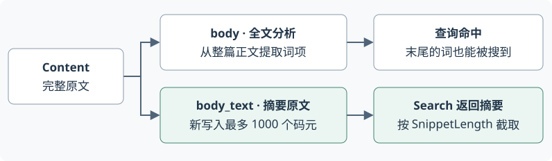

# 搜索一篇长文时要读多少正文

假设命中了八篇长文，每篇 131072 个 UTF-16 码元，调用方只要每篇开头 160 个。旧版已经会把返回字符串截成 160，但在截断之前，Lucene 要先把八份完整的原文取出来。找出这一步，要从 `Search` 里的 `Excerpt` 往前跟到写索引的 `BuildDocument`。[写入与版本判断](../DocumentSearchIndex.cs) · [查询与摘要](../DocumentSearchIndex.Query.cs)

## 摘要的大小在写入端就能确定

```csharp
// BuildDocument 旧版
document.Add(new TextField("body", Normalize(source.Content), Field.Store.NO));
document.Add(new StoredField("body_text", source.Content));

// 新版的第二行
document.Add(new StoredField("body_text", Excerpt(source.Content, MaximumSnippetLength)));
```

`body` 让分析器从整篇正文生成可检索的词项。`body_text` 则存一段可以原样读回的文字，保留原来的大小写和拼写。公开 API 允许的 `SnippetLength` 最大是 1000，因此新写文档只需为后者保留开头 1000 个码元。如果第 1000 个位置落在一个表情的两个代理码元中间，`Excerpt` 会退回一个位置。查询时再按实际请求的 160 截一次。



在这八篇文档里，旧版的摘要字段合计 1048576 个码元，新版最多 8000 个，最后向调用方返回的都是最多 1280 个。同机查询从 3.95 ms 降至 0.154 ms，托管分配从 3668086 B 降至 141867 B。Lucene 的压缩和分块读取会影响实际 I/O，码元数不能直接换算成读盘字节。`SnippetLength = 0` 时只请求元数据；要摘要时也复用同一组字段名，省去了每次查询重新复制 `HashSet` 的分配。[完整对照与测量条件](../../../docs/validation/NOTIFICATIONS-SEARCH-PERF/summary.md)

老索引也能打开，因为读出的 `body_text` 仍走同一个 `Excerpt`。既有文档继续承担旧存储字段的读取成本，写入较高版本或从源数据重建后才获得较短的字段。同版本重放只核对指纹，合并索引段也不会重新执行 `BuildDocument`。新写的文档仍能搜到正文末尾的词。

## 同版本重放怎样核对整篇内容

`ApplyBatch` 在 `Prepare` 中计算文档指纹。假设只改动了第 120000 个字符，即使摘要完全相同，同版本写入也应报冲突。这里必须把全文送入 SHA-256，可以省去的是中间那份与正文一样长的 UTF-8 字节数组。

```csharp
// Hash 旧版，在每个字段上执行
var bytes = Utf8.GetBytes(part);
BinaryPrimitives.WriteInt32BigEndian(length, bytes.Length);
hash.AppendData(length);
hash.AppendData(bytes);
```

每个字段先写四字节大端长度，再写该字段严格 UTF-8 编码的全部字节。例如 `汉😀` 占 3 个 UTF-16 码元，编码后为 7 字节，长度前缀就是 `00 00 00 07`。新版先算出这 7，再将正文编码到固定工作区，多次调用 `AppendData`。每次从编码器实际消耗的位置继续，因此跨块的表情仍然生成和原来相同的四个 UTF-8 字节。哈希只取决于这些字节的顺序，分几次提交不会改变指纹。[分段编码与哈希](../DocumentSearchIndex.cs)

下面这段循环复用 4096 字节的栈缓冲区。`charsRead` 表示从原字符串消耗了多少个码元，`bytesWritten` 表示实际向 SHA-256 提交多少字节，中文和表情让这两个数可能不同。[新版 Hash](../DocumentSearchIndex.cs#L263)

```csharp
while (!remaining.IsEmpty)
{
    System.Text.Unicode.Utf8.FromUtf16(remaining, buffer, out var charsRead, out var bytesWritten);
    hash.AppendData(buffer[..bytesWritten]);
    remaining = remaining[charsRead..];
}
```

写入文件名也有一处重复工作。过去 `name_g1`、`name_g2`、`name_g3` 各自执行一次 `Normalize(source.FileName)`。三个字段需要的是相同的 NFC 小写字符串，区别在于各自的分析器把它切成多长的词。现在在循环外算一次 `name`，供三个字段使用。[建立名称索引](../DocumentSearchIndex.cs#L224)

## 哪些查询需要计算游标签名

旧版每次进入 `Search` 都计算 `Hash(_identity, request.Scope, ...)`，即便查不到结果也会为分页准备签名。新版先准备归一化查询、扩展名和目录前缀，交给 `BuildQuery`；只有读取或生成游标时才调用局部函数 `CursorSignature()`。它用 `signature ??= Hash(...)` 缓存本次查询的计算结果。[查询与签名生成位置](../DocumentSearchIndex.Query.cs)

| 这次请求 | 何时用到签名 |
| --- | --- |
| 第一页没有命中，或所有命中都装得下 | 没有传入或返回游标，跳过签名计算 |
| 第一页还有下一页 | 收集完结果后计算一次，放入 `NextCursor` |
| 传入旧页的游标 | 搜索前计算并校验；若还有下一页，复用同一次计算 |

日期、范围、排序及匹配条件仍绑定原签名。基准分别测单页、带游标分页、有无摘要及重放；旧程序集生成的磁盘索引和游标也做了交叉打开验证。[测量条件与结果](../../../docs/validation/NOTIFICATIONS-SEARCH-PERF/summary.md)
