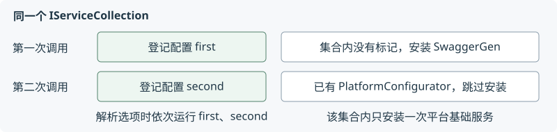

# Swagger 注册与路由配置的代码评审

宿主和功能模块都可以调用 `AddPlatformSwagger`。如果第一个调用配置文档标题，第二个配置路由，两份配置都要生效。问题出在另一个动作：旧版每次调用也会安装一遍 SwaggerGen。在旧版程序集上连续调用三次，实际解析出的 MVC 配置含有三个 `SwaggerApplicationConvention`。这笔耗时发生在宿主启动阶段。

## 为什么已经用了 TryAddEnumerable 还会重复注册

> 评审问题：旧代码里的“只添加一次”究竟保护了哪个调用？

```csharp
// 旧版 AddPlatformSwagger 的注册顺序，省略参数校验
services.AddEndpointsApiExplorer();
services.TryAddEnumerable(
    ServiceDescriptor.Transient<IConfigureOptions<SwaggerGenOptions>, ConfigureSwaggerGenOptions>());
services.AddSwaggerGen();
```

`TryAddEnumerable` 检查的是传给它的那一条描述符。下一行 `AddSwaggerGen()` 仍会执行，在其内部再次登记 MVC 约定和生成器相关选项。单看本包的 `ConfigureSwaggerGenOptions` 只有一个，很容易漏掉这个成本。回归测试因此直接读取容器里的 `MvcOptions.Conventions`，并另外检查使用者提供的配置顺序。[重复注册测试](../../../test/MS.Microservice.Swagger.Tests/SwaggerServiceCollectionExtensionsTests.cs)

> 评审问题：既然只需安装一次，为什么不在方法开头直接返回？

```csharp
if (setupAction is not null)
{
    services.Configure(setupAction);
}

if (!services.Contains(PlatformConfigurator))
{
    services.AddOptions();
    services.AddEndpointsApiExplorer();
    services.AddSwaggerGen();
    services.Add(PlatformConfigurator);
}
```

如果第二次调用一进方法就退出，第二个模块的配置会消失。新版先照常登记 `setupAction`，只对下半段安装基础服务的动作去重。`PlatformConfigurator` 是本包复用的一份服务描述符：检查的是**当前集合**里是否有它。另建一个宿主会得到自己的基础服务。宿主自己调用过 `AddSwaggerGen` 也不等于已经装过本包，宿主注册的文档和平台文档可以同时访问。[公开注册入口](../SwaggerServiceCollectionExtensions.cs#L8)



同一容器调用 16 次，耗时从 **44.965 降到 8.655 µs**，托管分配从 **36016 降到 9464 B**。单次调用是 2.960 → 2.851 µs。次数是基准显式控制的输入；只注册一次的服务应参考单次这一行。[测量条件与对照组](../../../docs/validation/SWAGGER-THREADING-PERF/summary.md)

## 为什么只在 UI 回调里复用路由前缀

> 评审问题：`RoutePrefix = "/tools/private/api-docs/"` 时，UI 需要几个不同的裁剪结果？

旧版在生成器回调里为 JSON 路由模板裁剪一次，在 UI 回调里又分别为 `BuildJsonEndpoint` 和 `NormalizeUiRoutePrefix` 裁剪一次。后两处面对同一个配置值，可以共享同一段字符串。

```csharp
// UseSwaggerUI 回调内，省略 OAuth 和显示选项
var prefix = SwaggerPathBuilder.NormalizeRoutePrefix(options.RoutePrefix);
swaggerUiOptions.SwaggerEndpoint(
    SwaggerPathBuilder.BuildJsonEndpoint(prefix, options.DocumentName),
    options.Name ?? options.DocumentTitle);
swaggerUiOptions.RoutePrefix = prefix;
```

以文档名 `v1` 为例，UI 路由使用 `tools/private/api-docs`，脚本中使用 `/tools/private/api-docs/v1/swagger.json`。JSON 中间件在自己的回调里解析前缀，生成保留 `{documentName}` 占位符的模板。空字符串仍表示网站根路径；`null`、纯空白、仅含斜杠的配置仍回退到 `swagger`。[两个回调](../ApplicationBuilderExtensions.cs#L25) · [路径边界测试](../../../test/MS.Microservice.Swagger.Tests/SwaggerPathBuilderTests.cs)

还比较过把 `prefix` 提到两个回调之外的写法。它可以只裁剪一次，但两个委托需要额外捕获这个局部值，默认前缀的管道配置每次多分配 8 B。最终选择在 UI 回调内部复用。带首尾斜杠时，分配从 **4656 降到 4584 B**，默认前缀持平；两组耗时都未测到改善。真正的 JSON 和 UI 请求在计时外验证，这些数字只说明配置管道时的成本。

XML 注释加载和 Bearer 安全定义也检查过。前者属于生成器选项配置，后者包含对当前 OpenAPI 文档的引用。这里没有按请求重复加载 XML 的证据，也没有跨文档共享安全对象的需要。[生成器配置](../ConfigureSwaggerGenOptions.cs) · [Bearer 定义](../SwaggerGenOptionsExtensions.cs)
