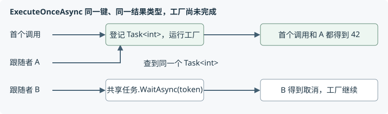

# 批处理索引与同键任务的代码评审

这两个改动都发生在业务函数执行之前。`CollectAsync` 给工作线程分配一个列表下标；`ExecuteOnceAsync` 决定自己运行工厂，还是等待已经开始的那一次。业务工作越短，这些准备步骤在总耗时里占的比例就越大。

## 批处理为什么直接把整数范围交给运行时

> 评审问题：调用方已经给了一个可以按下标访问的 `IReadOnlyList<T>`。工作线程还需要遍历什么？

```csharp
// 旧版调度入口
Parallel.ForEachAsync(Enumerable.Range(0, items.Count), options, body);

// 新版调度入口。这里的 body 是源码中的逐项异步委托
Parallel.ForAsync(0, count, options, body);
```

以四个工作线程处理 512 个输入为例。旧版 `Enumerable.Range` 不会创建一个装有 512 个整数的数组；它提供的是可枚举序列。工作线程通过同一个枚举器领下标，推进共享枚举器需要协调。新版直接告诉运行时“从 0 到 512，右端不包含”，可以按整数区间分发下标。任务完成得再乱，每个工作线程仍只写自己的 `results[index]`；单项异常仍进入相同位置的 `BatchItemResult`。[对照 CollectAsync 的调度与写回](../BatchProcessing.cs#L28)

同机 Release 基准里，512 项同步完成的小操作从 **292.016 降到 63.092 µs/批**，托管分配从 **64523 降到 21138 B/批**。另测 64 项实际执行 `await Task.Yield()` 的批次，耗时从 73.492 降到 50.655 µs。音频批量转换也使用这个入口，但这组数字只度量调度和示例委托，实际转码还要付出解码、编码与 I/O 的成本。[Audio 调用方](../../MS.Microservice.Audio/AudioProcessorExtensions.cs) · [完整基准](../../../docs/validation/SWAGGER-THREADING-PERF/summary.md)

> 评审问题：空列表可以直接返回，那为什么 `count == 0` 分支里还有一次取消检查？

```csharp
cancellationToken.ThrowIfCancellationRequested();
int count = items.Count;
if (count == 0)
{
    cancellationToken.ThrowIfCancellationRequested();
    return ReadOnlyCollection<BatchItemResult<TResult>>.Empty;
}
```

`items.Count` 是调用方实现的属性。进入方法时令牌可能有效，读取属性期间却可能发生取消。第一次检查保证预取消时连属性也不访问，第二次保证这段时间内的取消不会变成一次成功的空批。共享的只读空结果省下了结果数组和并行调度，整个公开调用仍有 120 B 托管分配。这个时序有专门的回归用例。[空批返回](../BatchProcessing.cs#L20) · [取消和批处理测试](../../../test/MS.Microservice.Threading.Tests/BatchTests.cs)

## 同键请求命中时为什么不必再创建完成源

> 评审问题：第一个调用还在加载，后来 64 个调用都要同一个结果。原代码里的哪个对象只会被其中一个调用使用？

```csharp
// 旧版：每个调用走到 GetOrAdd 之前，candidate 和它的 Task 都已创建
var candidate = new TaskCompletionSource<object?>(TaskCreationOptions.RunContinuationsAsynchronously);
var shared = _inFlight.GetOrAdd(identity, candidate);
return (T)(await shared.Task.WaitAsync(cancellationToken).ConfigureAwait(false))!;
```

第一个调用登记成功后，后来的调用虽然从 `GetOrAdd` 拿回旧条目，却已经为本次候选分配了对象。它们还各自等待 `Task<object?>`，把结果转回 `T`；如果工厂返回 `int`，结果在交给 `object` 时还要装箱一次。这里有两个不同的角色：工厂拥有者需要一个能设置结果的完成源，等待者只需一个能等待的任务。

```csharp
// 新版 ExecuteOnceAsync：已经有任务时，不创建候选
if (key is not null && action is not null && !cancellationToken.IsCancellationRequested
    && _inFlight.TryGetValue((key, typeof(T)), out var shared))
{
    return ((Task<T>)shared).WaitAsync(cancellationToken);
}
return StartOrJoinAsync(key, action, cancellationToken);
```

字典的键同时包含字符串和 `typeof(T)`。所以字典能以 `Task` 容纳不同结果类型，取出时仍可以安全地转回该键对应的 `Task<T>`。两个调用都在条目出现前查找，仍可能各建一个候选；`StartOrJoinAsync` 用原子的 `GetOrAdd(identity, candidate.Task)` 选出胜者，只有胜者调用工厂。基准让首个工厂挂起后再加入 64 名等待者，这种命中场景从 **32.892 降到 6.450 µs/组**，分配从 **18218 降到 1146 B/组**。只来一个同步完成的工厂时，分配从 248 降到 224 B，耗时则从 0.277 变为 0.283 µs。[命中直接返回](../SingleflightManager.cs#L17) · [竞争时决定谁执行](../SingleflightManager.cs#L32)



> 评审问题：一个等待者取消，谁负责把共享任务从字典里移除？

每个调用把自己的令牌交给 `WaitAsync`。没有可取消令牌时可以直接复用共享任务；有令牌时由运行时管理这名调用者的等待。清理工作仍在工厂拥有者的 `PublishAsync`：先按“键和本次任务实例”精确移除，再设置结果或发布异常。这样，旧等待者恢复时不会删除同键下一次操作。[移除与唤醒的先后顺序](../SingleflightManager.cs#L53)

这里保留了一个真正的异步入口 `StartOrJoinAsync`。如果调用前已经取消，它和旧版一样先检查参数，再用 `ThrowIfCancellationRequested` 把带原令牌的 `OperationCanceledException` 传给返回的任务。实测过直接返回 `Task.FromCanceled<T>` 的写法；任务状态相同，但等待时得到的具体异常变成了 `TaskCanceledException`。此外，如果仅给默认令牌调用做快速返回，那么 64 名都带可取消令牌的跟随者会多分配约 7.5 KB。把快速返回的判断放在“已有有效任务”这一层，可以同时照顾这两种调用者。[参数、取消与并发回归](../../../test/MS.Microservice.Threading.Tests/SingleflightTests.cs)

模块里的 `SemaphoreSlim.AcquireAsync` 还承担独立的所有权约束。每个成功取得的名额对应一份租约；`Interlocked.Exchange` 保证同一租约即使重复释放，也只归还一个名额。复用一个仍可能被旧调用者持有的租约会破坏这个保证，因此这里保留按次创建的实现。[租约源码](../SemaphoreSlimExtensions.cs)
